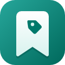
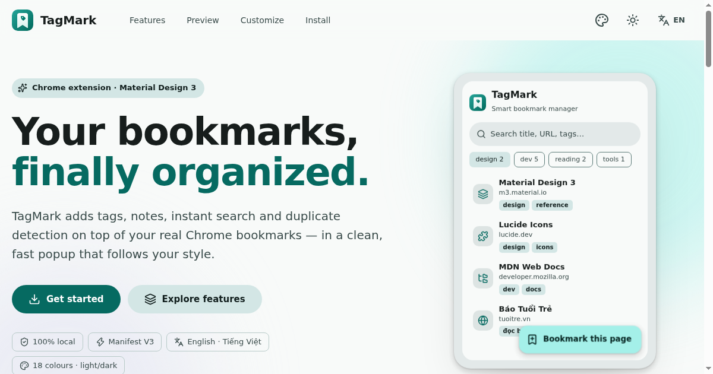
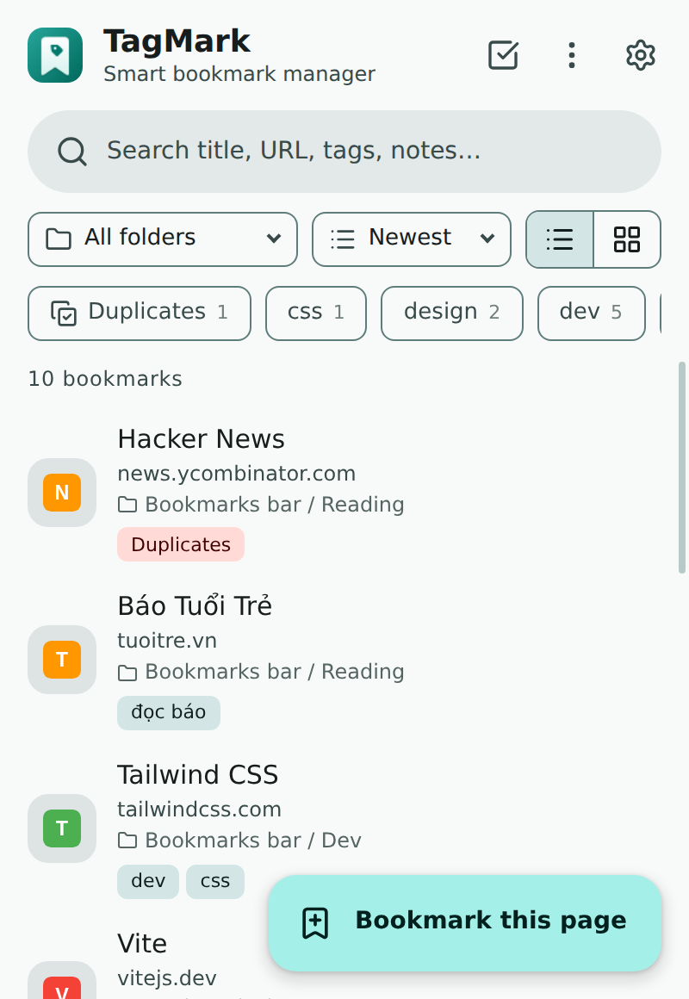
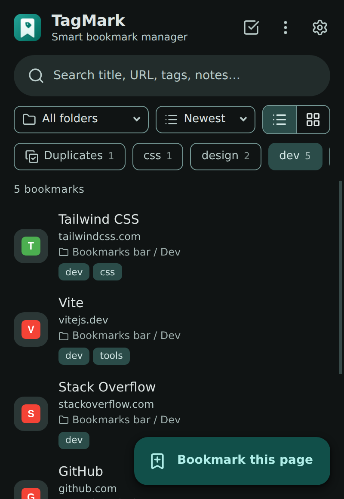
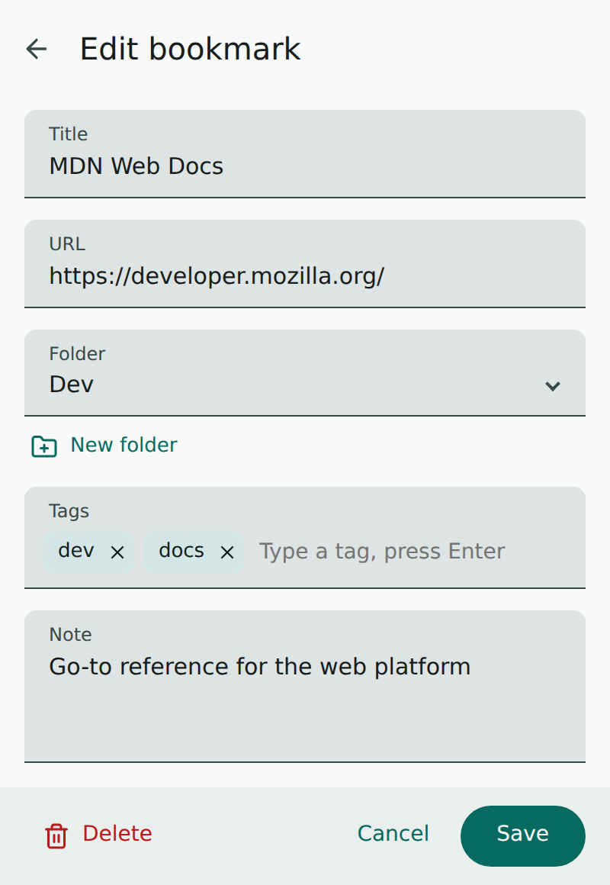
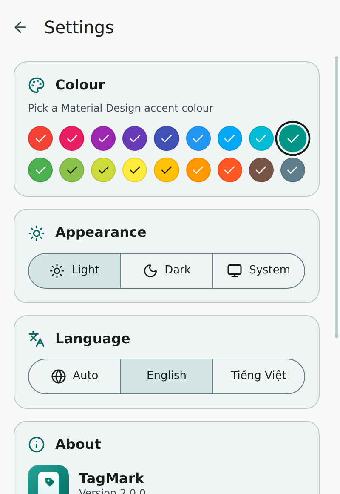
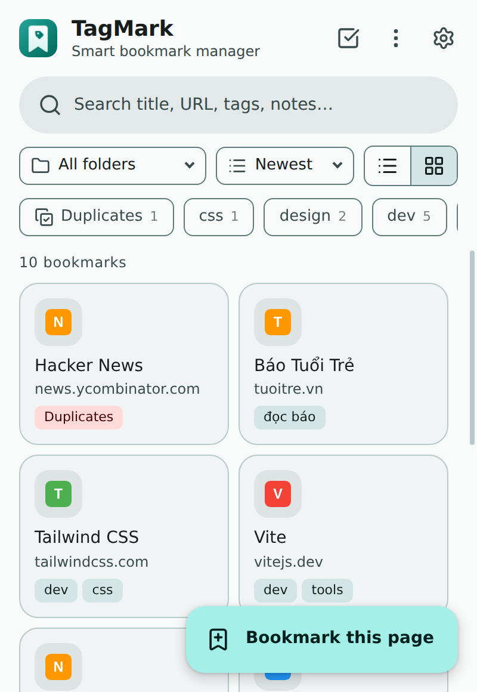
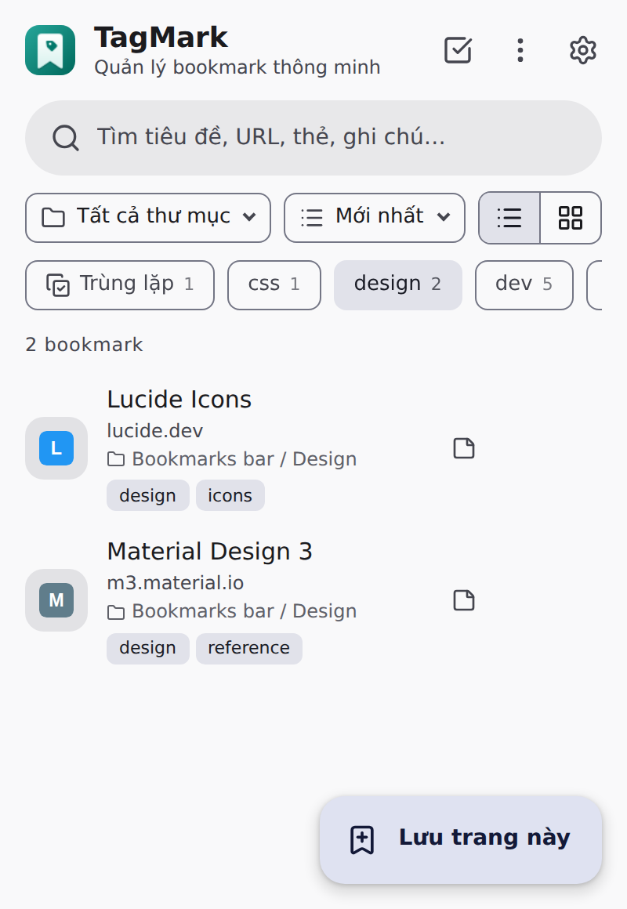
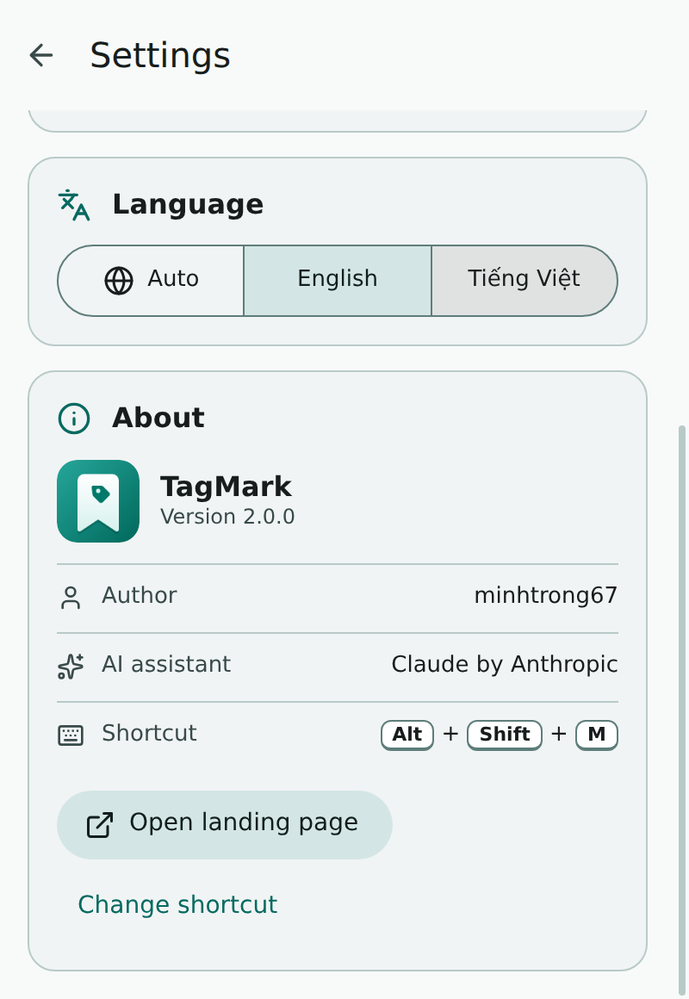

<div align="center">



# TagMark — Smart Bookmark Manager

**Tags, notes, instant search and duplicate detection for your real Chrome bookmarks.**
Material Design 3 · Light / Dark · English & Tiếng Việt · 100% local


[English](#-english) · [Tiếng Việt](#-tiếng-việt) · [Landing page](landing.html)



</div>

---

## 🇬🇧 English

### Overview
TagMark is a Chrome extension that works **directly on your real bookmarks** through the official `chrome.bookmarks` API. Everything you add, edit, move or delete shows up in `chrome://bookmarks` and vice-versa. On top of that TagMark adds what Chrome lacks: custom **tags**, private **notes**, accent-insensitive **instant search**, **duplicate detection** and **bulk actions** — wrapped in a clean Material Design 3 popup.

### Screenshots

| | | |
|:---:|:---:|:---:|
|  |  |  |
| **Bookmark list** — search, folder filter, tags, sort | **Dark mode** — filtered by the `dev` tag | **Edit** — tags, note, folder |
|  |  |  |
| **Settings** — colour, appearance, language | **Grid view** — compact visual browsing | **Vietnamese** — with a custom accent colour |
|  | | |
| **About** — author, AI assistant, landing page | | |

### Features
- **One-click “Bookmark this page”** — saves the active tab and opens it for tagging; never creates a duplicate.
- **Instant search** across title, URL, tags and notes — accent-insensitive (typing `bao tuoi` finds *Báo Tuổi Trẻ*).
- **Tags & notes** — filter by tag with one tap; tag suggestions while typing; comma or Enter to add.
- **Duplicate detection** — a *Duplicates* chip appears automatically when the same URL is saved more than once.
- **Folders** — filter by any folder (subfolders included) and create new folders while editing.
- **Multi-select & bulk actions** — tag or delete many bookmarks at once.
- **List or grid view**, sort by newest / A→Z / Z→A — your choices are remembered.
- **Keyboard shortcut** `Alt` + `Shift` + `M` — bookmark the current tab instantly, with a native notification.
- **Toolbar badge** — total bookmark count, coloured with your theme.
- **Backup & export** — JSON backup (tags/notes), standard HTML export with nested folders, JSON import with smart merge.
- **Live sync** — changes made in `chrome://bookmarks` or by Chrome Sync appear in the popup immediately.

### Settings
The settings page opens **inside the popup** (no new tab) and is intentionally small:

| Section | What you can do |
|---|---|
| **Colour** | Pick one of the **18 Material Design colours**; the full light/dark scheme is derived from it |
| **Appearance** | **Light**, **Dark** or **System** (auto-detects) |
| **Language** | **Auto** (detects your browser), **English** or **Tiếng Việt** |
| **About** | Author `minhtrong67` · built with the help of AI **Claude** · button to open the bundled landing page in a new tab |

### Installation (developer mode)
1. Unzip the package into a folder you will keep.
2. Open `chrome://extensions` and enable **Developer mode**.
3. Click **Load unpacked** and choose the `bookmark-manager` folder.
4. Pin **TagMark** to the toolbar. Change the shortcut any time at `chrome://extensions/shortcuts`.

> Works on Chrome 105+ and other Chromium browsers (Edge, Brave, Vivaldi, Opera) that support Manifest V3.

### Usage tips
| Action | How |
|---|---|
| Save the current page | Click **Bookmark this page**, or press `Alt+Shift+M` |
| Edit / copy URL | Hover a row and use the pencil / copy buttons |
| Select several bookmarks | Toggle the **select** icon in the top bar |
| Export / import / reset | Top bar **⋮** menu |
| Close dialogs, menus or sub-screens | `Esc` |

### Landing page
`landing.html` (project root) is a self-contained, responsive, animated Material Design 3 page with live colour / theme / language switching and full SEO + Open Graph + Twitter Card + JSON-LD metadata. It opens from **Settings → Open landing page** and can also be hosted on any static host (GitHub Pages, Netlify, Cloudflare Pages…).
After deploying, replace the relative `og:image` / `twitter:image` values (`screenshots/image07.png`) with absolute URLs so social networks can fetch the preview, and add your `og:url` / canonical link.

### Project structure
```text
bookmark-manager/
├── manifest.json            # Manifest V3
├── popup.html               # Popup UI (list · edit · settings)
├── landing.html             # Single-file landing page (SEO + social meta)
├── README.md
├── _locales/                # Store name/description (en, vi)
├── css/popup.css            # Material Design 3 components (system font)
├── js/
│   ├── background.js        # Service worker: badge, shortcut, metadata cleanup
│   ├── main.js              # Popup logic
│   ├── storage.js           # chrome.storage layer (settings + tags/notes)
│   ├── theme.js             # Material colour engine (seed → light/dark scheme)
│   ├── i18n.js              # English / Vietnamese dictionary
│   └── icons.js             # Lucide icons, inlined
├── icons/                   # icon.svg + 16/32/48/128 px PNG
└── screenshots/             # image01.png … image08.png
```

### Permissions & privacy
| Permission | Why |
|---|---|
| `bookmarks` | Read and manage your bookmarks |
| `storage` | Keep tags, notes and settings on your device |
| `favicon` | Show site icons from Chrome's own favicon cache |
| `activeTab` | Read the title/URL of the tab you bookmark |
| `notifications` | Confirm the `Alt+Shift+M` shortcut |

TagMark makes **no network requests**, has no analytics and no remote code. All data stays in `chrome.storage.local`.

### Tech stack
Vanilla JavaScript (no build step) · Manifest V3 service worker · Material Design 3 tokens · [Lucide](https://lucide.dev) icons · system font stack.

### Changelog
**2.0.0**
- Complete Material Design 3 redesign with system font and Lucide icons; new 18-colour theme engine with accessible light/dark schemes.
- Slimmer settings: colour, appearance, language, about; export/import/reset moved to the ⋮ menu.
- New extension icon (16/32/48/128 px) and bundled landing page.
- Material dialogs replace the browser's `confirm()` / `prompt()`.
- **Fixes:** quick-add shortcut ignored the saved folder (wrong storage key); installer polluted the root of `chrome.storage`; the language selector could not return to *Auto*; blank titles were saved as “Add Bookmark”; URLs without a scheme (`example.com`) were rejected; imports could create duplicate bookmarks within one file; deleting a folder left orphaned notes/tags; search ignored notes and Vietnamese diacritics; popup did not refresh after external bookmark changes; list items were re-bound on every render (now event delegation).

**1.1.0** — initial public package.

### Credits
Created by **minhtrong67** with the support of AI assistant **Claude** (Anthropic). Icons by [Lucide](https://lucide.dev) (ISC).

### License
MIT © minhtrong67

---

## 🇻🇳 Tiếng Việt

### Giới thiệu
TagMark là tiện ích Chrome làm việc **trực tiếp trên bookmark thật** của bạn thông qua API `chrome.bookmarks`. Mọi thao tác thêm, sửa, chuyển, xoá đều đồng bộ với `chrome://bookmarks` và ngược lại. TagMark bổ sung những gì Chrome còn thiếu: **thẻ (tag)**, **ghi chú** riêng tư, **tìm kiếm tức thì** không phân biệt dấu, **phát hiện trùng lặp** và **thao tác hàng loạt** — trong giao diện Material Design 3 gọn gàng.

### Ảnh chụp màn hình
Xem bảng ảnh ở phần [Screenshots](#screenshots): danh sách, chế độ tối, chỉnh sửa, cài đặt, dạng lưới, giao diện tiếng Việt và phần giới thiệu.

### Tính năng
- **Lưu trang hiện tại một chạm** và mở ngay màn hình gắn thẻ; không bao giờ tạo bản trùng.
- **Tìm kiếm tức thì** theo tiêu đề, URL, thẻ và ghi chú — không phân biệt dấu (gõ `bao tuoi` vẫn ra *Báo Tuổi Trẻ*).
- **Thẻ & ghi chú** — lọc theo thẻ bằng một chạm, gợi ý thẻ khi nhập, nhấn Enter hoặc dấu phẩy để thêm.
- **Phát hiện trùng lặp** — chip *Trùng lặp* tự xuất hiện khi một URL được lưu nhiều lần.
- **Thư mục** — lọc theo thư mục (gồm thư mục con), tạo thư mục mới ngay khi chỉnh sửa.
- **Chọn nhiều & thao tác hàng loạt** — gắn thẻ hoặc xoá nhiều bookmark cùng lúc.
- **Dạng danh sách hoặc lưới**, sắp xếp mới nhất / A→Z / Z→A — tự ghi nhớ lựa chọn.
- **Phím tắt** `Alt` + `Shift` + `M` — lưu nhanh tab hiện tại, có thông báo xác nhận.
- **Huy hiệu trên thanh công cụ** — tổng số bookmark, theo màu giao diện.
- **Sao lưu & xuất** — sao lưu JSON (thẻ/ghi chú), xuất HTML chuẩn có thư mục lồng nhau, nhập JSON với cơ chế gộp thông minh.
- **Đồng bộ tức thì** — thay đổi ở `chrome://bookmarks` hoặc Chrome Sync hiện ngay trong popup.

### Cài đặt trong popup
Trang cài đặt mở **ngay trong extension** (không cần tab mới) và chỉ gồm:
- **Màu sắc** — 18 màu Material Design, toàn bộ bảng màu sáng/tối được tạo tự động từ màu bạn chọn.
- **Giao diện** — Sáng / Tối / Hệ thống (tự nhận diện).
- **Ngôn ngữ** — Tự động (nhận diện từ trình duyệt) / English / Tiếng Việt.
- **Giới thiệu** — tác giả `minhtrong67`, hỗ trợ bởi AI **Claude**, nút mở trang landing page ở tab mới.

### Cài đặt extension
1. Giải nén gói vào một thư mục bạn sẽ giữ lại.
2. Mở `chrome://extensions` và bật **Chế độ nhà phát triển**.
3. Nhấn **Tải tiện ích đã giải nén** và chọn thư mục `bookmark-manager`.
4. Ghim **TagMark** lên thanh công cụ. Đổi phím tắt tại `chrome://extensions/shortcuts`.

### Quyền truy cập & quyền riêng tư
TagMark **không gửi bất kỳ yêu cầu mạng nào**, không có phân tích hay mã từ xa. Toàn bộ dữ liệu (thẻ, ghi chú, cài đặt) nằm trong `chrome.storage.local` trên thiết bị của bạn.

### Tác giả
Thực hiện bởi **minhtrong67** với sự hỗ trợ của AI **Claude** (Anthropic). Giấy phép MIT.
