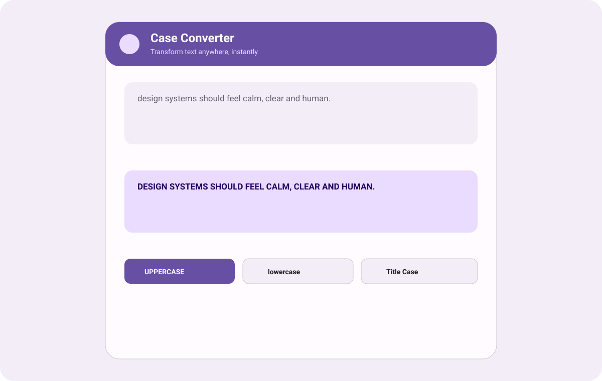
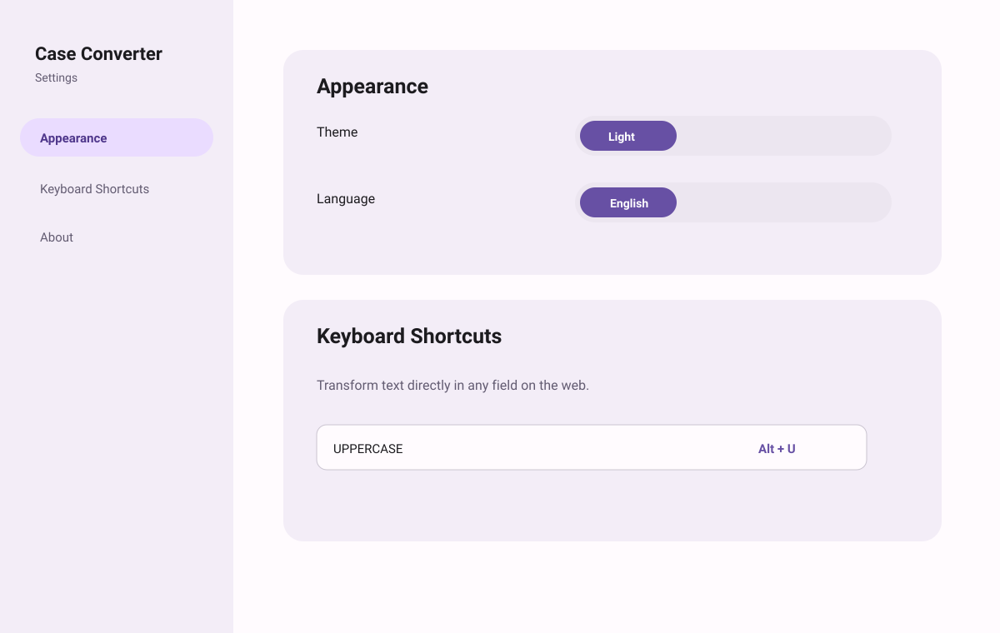
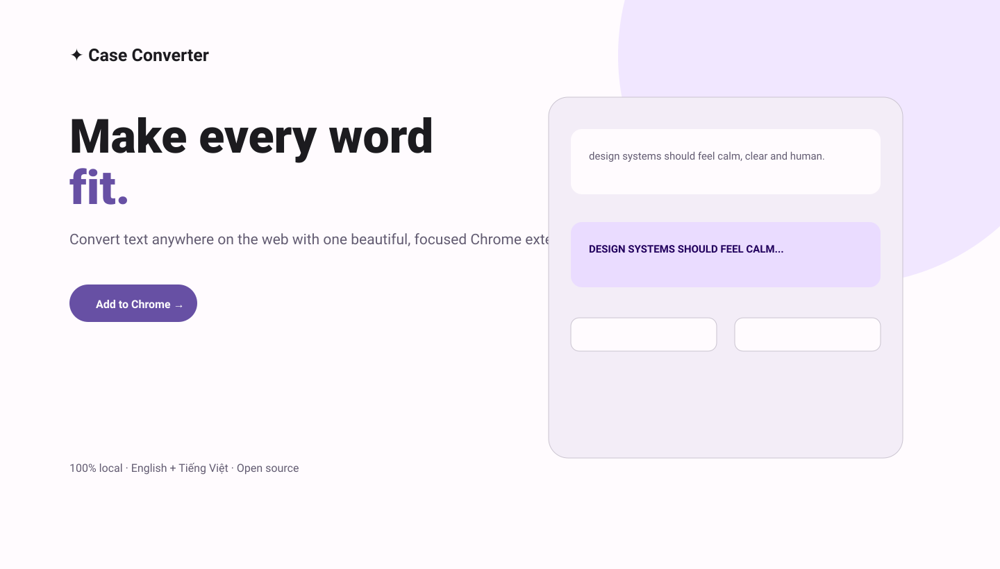

# Case Converter

> Chrome extension chuyển đổi kiểu chữ theo phong cách Material Design 3 — nhanh, riêng tư và hoạt động ngay trong nơi bạn đang viết.

**Tác giả:** [minhtrong67](https://github.com/minhtrong67) · **Hỗ trợ AI:** Claude

[English](#english) · [Tiếng Việt](#tiếng-việt)

---

## English

### Introduction

Case Converter is a lightweight Manifest V3 Chrome extension for transforming text anywhere on the web. It combines a focused popup, in-page keyboard shortcuts, context-menu actions and responsive settings. Every transformation runs locally in the browser: text never leaves your device.

### Screenshots

| Popup | Settings | Landing page |
|---|---|---|
|  |  |  |

Screenshots live in `screenshots/` and use the `image01`, `image02`, `image03` naming convention.

### Features

- **11 transformations:** UPPERCASE, lowercase, Capitalize Each Word, Sentence case, Title Case, alternating case, inverse case, `snake_case`, `kebab-case`, `camelCase` and trim extra spaces.
- **In-page shortcuts:** transform the active input, textarea or rich `contenteditable` editor without leaving the current page.
- **Selection-aware editing:** convert only selected text when a selection exists; otherwise convert the complete field.
- **Context menu:** convert selected text or the active editable field from the right-click menu.
- **Material Design 3 UI:** tonal surfaces, accessible focus states, responsive layout and smooth micro-interactions.
- **Themes:** Light, Dark and System, plus Material-inspired accent palettes: Purple, Blue, Green, Orange, Pink and Teal.
- **Languages:** English and Vietnamese. First launch automatically follows the browser/device locale.
- **Roboto by default:** optional Be Vietnam Pro and Inter choices.
- **Site exclusions:** disable in-page shortcuts for selected domains.
- **Privacy first:** no analytics, tracking, remote code or server-side text processing.
- **Landing page:** one responsive HTML page with SEO metadata, Open Graph/Twitter cards, mobile layout and reduced-motion support, available from Settings.

### Installation

1. Download or clone this repository.
2. Open `chrome://extensions` in Chrome or another Chromium-based browser.
3. Enable **Developer mode**.
4. Click **Load unpacked**.
5. Select the `case-converter-ext` folder.
6. Pin Case Converter to your toolbar.

### Usage

1. Click the extension icon to open the popup.
2. Type or paste text into the input field.
3. Choose a transformation chip.
4. Use **Copy** or **Use as input** to chain transformations.
5. On any website, focus an editable field and press a configured shortcut. Select text first to transform only that selection.
6. Open **Settings** from the gear icon to customize theme, language, accent color, font, shortcuts and disabled sites.
7. Use **View landing page** inside Settings to open the product introduction page.

### Tech stack

- Chrome **Manifest V3**
- Plain **HTML, CSS and JavaScript** — no framework or bundler
- Material Design 3-inspired design tokens and responsive CSS
- `chrome.storage.sync` for settings
- Unicode-aware JavaScript transforms using `\p{L}`
- SVG/PNG icons in 16, 32, 48 and 128 px sizes
- Roboto typography with graceful system fallbacks

### Development

```bash
cd case-converter-ext
node --check js/settings.js
node --check js/i18n.js
node --check popup/popup.js
node --check options/options.js
node --check content.js
```

Load the directory as an unpacked extension and reload it from `chrome://extensions` after changes. The shared transformation API is `CaseUtils.apply(id, text)`.

### Build

There is no compilation step. To produce a distributable zip:

```bash
./build.sh
# or
./build.sh ../case-converter-ext.zip
```

The script excludes macOS metadata and `.git` files.

### Project structure

```text
case-converter-ext/
├── manifest.json              # Manifest V3 configuration
├── background.js              # Context-menu service worker
├── content.js                 # In-page shortcut and editor integration
├── content.css                # In-page toast notification
├── index.html               # Responsive SEO-friendly product page
├── build.sh                   # Reproducible zip packaging script
├── popup/                     # Popup UI
├── options/                   # Settings UI
├── js/
│   ├── case-utils.js          # Pure Unicode-safe transformations
│   ├── i18n.js                # English/Vietnamese strings
│   └── settings.js            # Defaults, storage and theme helpers
├── icons/                     # SVG source and PNG extension icons
├── screenshots/               # image01.svg, image02.svg, image03.svg
├── _locales/                  # Chrome Web Store locale metadata
├── PRIVACY.md                 # Privacy policy
├── LICENSE                    # MIT license
└── README.md
```

### License

This project is public and open source under the **MIT License**. See [`LICENSE`](LICENSE).

---

## Tiếng Việt

### Giới thiệu

Case Converter là tiện ích Chrome Manifest V3 giúp chuyển đổi kiểu chữ ở bất kỳ đâu trên web. Tiện ích có popup gọn gàng, phím tắt ngay trong trang, menu chuột phải và trang cài đặt responsive. Toàn bộ nội dung được xử lý cục bộ trên trình duyệt, không gửi lên máy chủ.

### Screenshot

Ba ảnh minh hoạ nằm trong thư mục [`screenshots`](screenshots/): `image01.svg` (popup), `image02.svg` (cài đặt) và `image03.svg` (landing page).

### Tính năng

- 11 kiểu chuyển đổi: chữ hoa, chữ thường, viết hoa từng từ, đầu câu, tiêu đề, xen kẽ, đảo ngược, `snake_case`, `kebab-case`, `camelCase` và xoá khoảng trắng thừa.
- Phím tắt hoạt động trực tiếp trong input, textarea và trình soạn thảo `contenteditable`.
- Nếu có bôi chọn, chỉ phần được chọn sẽ chuyển đổi.
- Menu chuột phải để chuyển đổi nhanh.
- Giao diện Material Design 3 với animation và hiệu ứng nhẹ, mượt.
- Chủ đề Sáng / Tối / Theo hệ thống cùng 6 màu Material: Tím, Xanh dương, Xanh lá, Cam, Hồng, Xanh ngọc.
- Hỗ trợ English và Tiếng Việt; lần mở đầu tự nhận diện ngôn ngữ thiết bị.
- Roboto là font mặc định; có thể chọn thêm Be Vietnam Pro hoặc Inter.
- Danh sách tên miền để tắt phím tắt khi cần.
- Không analytics, không tracking, không remote code và không xử lý văn bản trên server.
- Landing page một file HTML, responsive mobile, có meta SEO, Open Graph/Twitter và hiệu ứng tôn trọng `prefers-reduced-motion`.

### Cài đặt

1. Tải hoặc clone repository.
2. Mở `chrome://extensions` trên Chrome/Edge/Brave/Opera.
3. Bật **Chế độ nhà phát triển**.
4. Chọn **Tải tiện ích đã giải nén**.
5. Chọn thư mục `case-converter-ext`.
6. Ghim tiện ích lên thanh công cụ.

### Tech stack

HTML, CSS, JavaScript thuần, Manifest V3, Chrome Storage API, Unicode RegExp, SVG/PNG và CSS responsive. Không dùng framework hoặc bundler.

### Development

```bash
cd case-converter-ext
node --check js/settings.js
node --check js/i18n.js
node --check popup/popup.js
node --check options/options.js
node --check content.js
```

Dùng `CaseUtils.apply(id, text)` để gọi các hàm chuyển đổi dùng chung giữa popup và content script.

### Build

Không cần compile. Chạy `./build.sh` để tạo file zip sẵn sàng phân phối.

### Cấu trúc project

Xem sơ đồ cấu trúc đầy đủ ở phần [Project structure](#project-structure) phía trên. Các file chính gồm popup, options, landing page, `js/case-utils.js`, `js/i18n.js`, `js/settings.js`, `content.js`, `background.js`, thư mục `icons/` và `screenshots/`.

### Attribution

Dự án được thực hiện bởi **minhtrong67** với sự hỗ trợ của **Claude AI**.

### License

Dự án public và open source, phát hành theo **MIT License**. Xem [`LICENSE`](LICENSE).
