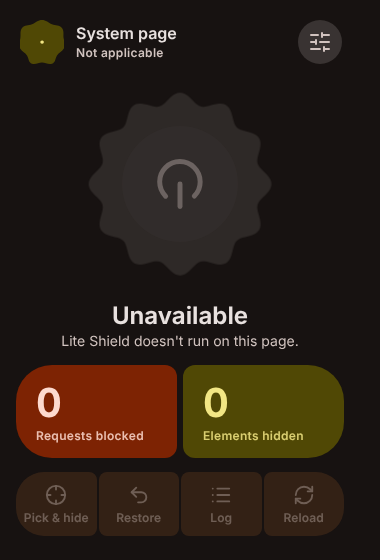
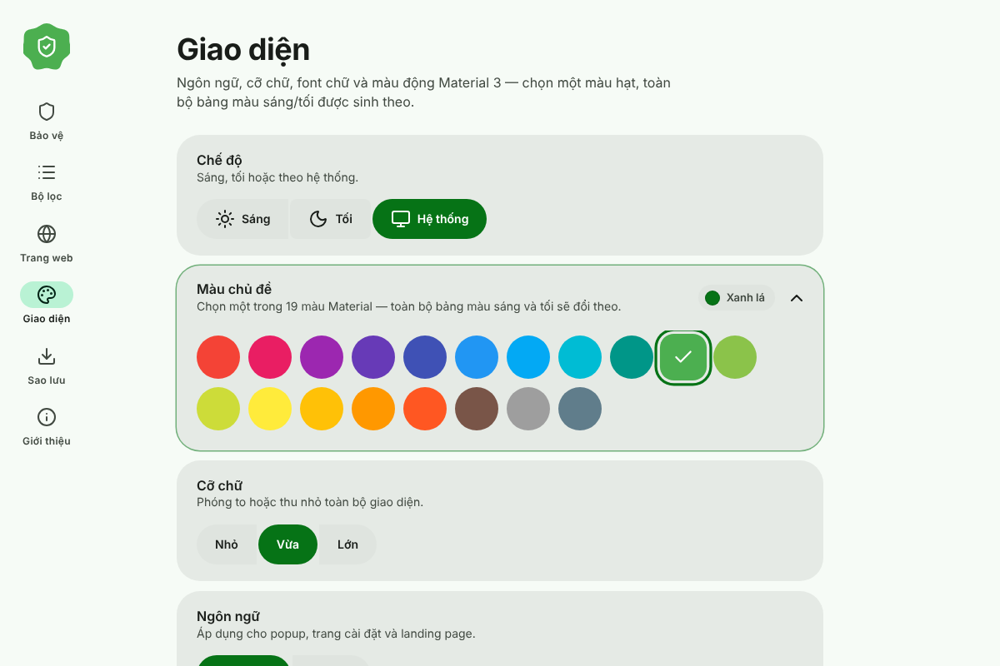
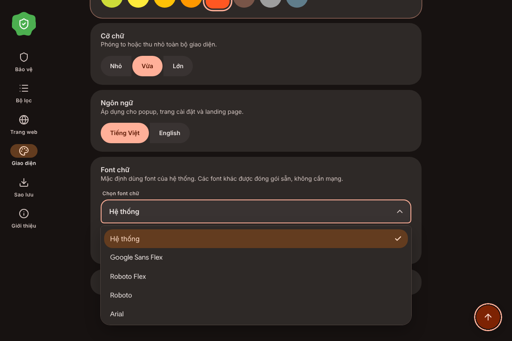
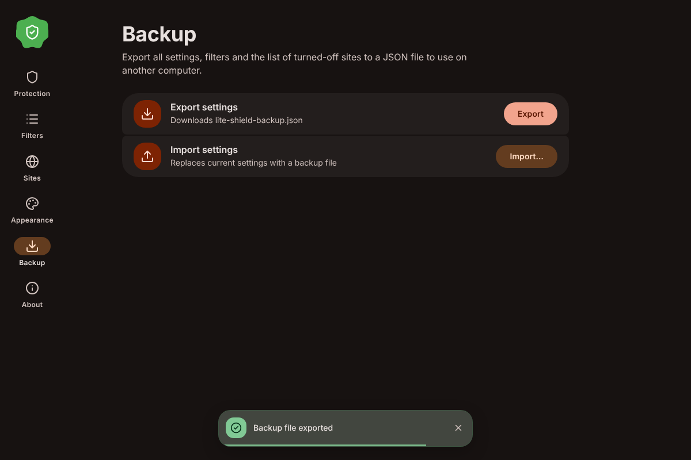

<div align="center">


# Lite Shield

**A lightweight, privacy-first content blocker for Chrome (Manifest V3) — styled in Material 3 Expressive.**

[Tiếng Việt](README.vi.md) · English

   

</div>

Lite Shield is a personal take on [uBlock Origin Lite](https://github.com/uBlockOrigin/uBOL-home): it blocks ads and trackers using Chrome's `declarativeNetRequest` engine, so it never reads your pages' network traffic and needs no always-on background process. The interface is rebuilt from scratch with Material 3 Expressive — dynamic color, springy shape morphing and a lot of small, purposeful motion.

<p align="center">
  
  
</p>

## Features

**Protection**
- Network blocking with EasyList + EasyPrivacy compiled to static DNR rulesets (Ads, Trackers, Annoyances).
- Cosmetic filtering: generic element hiding plus per-site rules, with a validated selector engine (`:is()` batching for loose selectors, nested `:has()` rejected).
- YouTube ad scriptlet running in the page's main world (can be switched off).
- **Element zapper** — pick any element and hide it permanently (`Alt+Shift+X` or right-click menu).
- **Block log** for the current tab with one-click per-domain *Allow*.
- Per-site on/off, custom filters (ABP/uBO syntax) with line-by-line error reporting.
- Lists auto-update on a schedule, or on demand.
- Block statistics (today / all time).
- Backup & restore everything as one JSON file.

**Personalization** (Settings → Appearance)

| Option | Choices |
|---|---|
| Mode | Light · Dark · System (circular reveal transition) |
| Theme color | 19 Material colors — Red, Pink, Purple, Deep Purple, Indigo, Blue, Light Blue, Cyan, Teal, **Green (default)**, Light Green, Lime, Yellow, Amber, Orange, Deep Orange, Brown, Grey, Blue Grey |
| Text size | Small · Medium · Large |
| Language | English · Tiếng Việt |
| Typeface | System (default) · Google Sans Flex · Roboto Flex · Roboto · Arial · Inter · Be Vietnam Pro |

The full light/dark palette is generated from the chosen color in OKLCH; all 19 colors keep ≥ 4.5 : 1 contrast on every text/surface pair (checked in both schemes). Fonts are bundled, so they work offline and nothing is fetched from a CDN.

<p align="center">
  
  
</p>

**UI details**
- Custom dropdown (ARIA combobox/listbox) with a capped height, scrolling and full keyboard support — it follows light/dark, unlike a native `<select>`.
- Accordions for long sections (colors, preview, credits).
- Toasts in four variants (`info`, `success`, `warning`, `error`) for both schemes, used only for outcomes that matter: saving filters, updating lists, backup, errors. Simple toggles and list edits give feedback in place, and invalid input is flagged inline.
- Custom tooltips for icon buttons (hover and keyboard focus, with shortcut hints).
- Scroll-to-top button with a scroll-progress ring and smooth scrolling.
- Ripples, spring shape-morphing, scroll reveal, animated counters. Everything respects `prefers-reduced-motion`.
- Lucide icons throughout.

## Performance

- Network blocking runs inside Chrome (`declarativeNetRequest`), not in JavaScript.
- Generic element hiding is applied *on demand*: each page reports only the class/id names it contains and Lite Shield hides the matches, instead of loading ~13,000 CSS rules into every tab (≈ 1 MB per tab instead of ≈ 5 MB).
- The service worker sleeps when idle and keeps under 3 MB of JavaScript heap; enabling the optional block log keeps it awake while pages load.
- AdGuard Base is off by default (it adds ~18,000 network rules). Turn off lists you don't need in Settings → Protection.
- Measure it yourself: `npm run test:memory`.

## Install (developer mode)

1. Download or clone this folder.
2. Open `chrome://extensions` and enable **Developer mode**.
3. Click **Load unpacked** and select the folder that contains `manifest.json`.
4. Pin the extension; set the zapper shortcut at `chrome://extensions/shortcuts` if you like.

## Permissions

| Permission | Why |
|---|---|
| `declarativeNetRequest`, `declarativeNetRequestFeedback` | Block requests; show the block log and counters |
| `storage` | Your settings and filters (local only) |
| `scripting`, `activeTab`, `<all_urls>` | Inject cosmetic CSS, the zapper and the YouTube scriptlet |
| `webRequest`, `webNavigation` | Detect blocked requests for the log and badge (read-only) |
| `alarms` | Scheduled list updates |
| `contextMenus` | “Hide an element” menu item |

No analytics, no remote code. The only network requests are the optional list updates to GitHub-hosted filter lists.

## Project structure

```
manifest.json  background.js  content.js  picker.js
popup/      toolbar popup
options/    settings (Protection · Filters · Sites · Appearance · Backup · About)
landing/    introduction page
shared/     theme (19-color OKLCH), i18n + lang/, toast, tooltip, select, effects,
            filters (ABP compiler), selector (validator), icons (Lucide), ui.css
scriptlets/ YouTube main-world scriptlet
rulesets/   compiled DNR rulesets      lists/  vendored filter lists
fonts/      bundled WOFF2 (OFL)        tools/  list fetch + ruleset build + tests
```

## Development

```bash
npm run fetch      # download EasyList / EasyPrivacy into lists/vendor
npm run build      # compile rulesets + generic cosmetic data
npm test           # filter/selector unit tests + i18n key parity
```

Adding a language: copy `shared/lang/en.js` to `shared/lang/<code>.js`, translate it, and register it in `shared/i18n.js`.

## Credits

Designed and built by **minhtrong67**, with AI support from **Claude** (Anthropic).
Source: <https://github.com/minhtrong67/my-chrome-extensions>

Inspired by uBlock Origin Lite (code written from scratch). Filter lists © EasyList authors. Icons: [Lucide](https://lucide.dev) (ISC). Fonts: SIL OFL 1.1. See [THIRD_PARTY.md](THIRD_PARTY.md).
