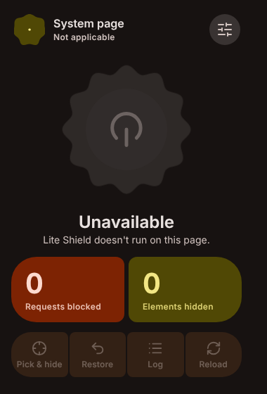
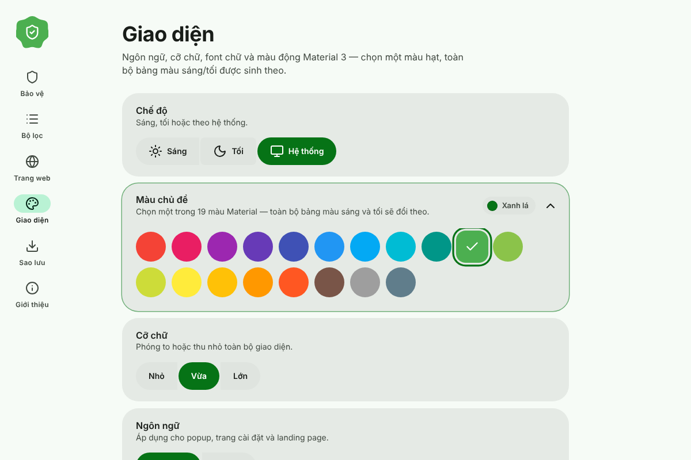
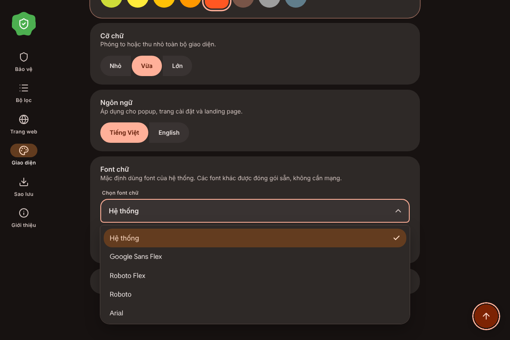
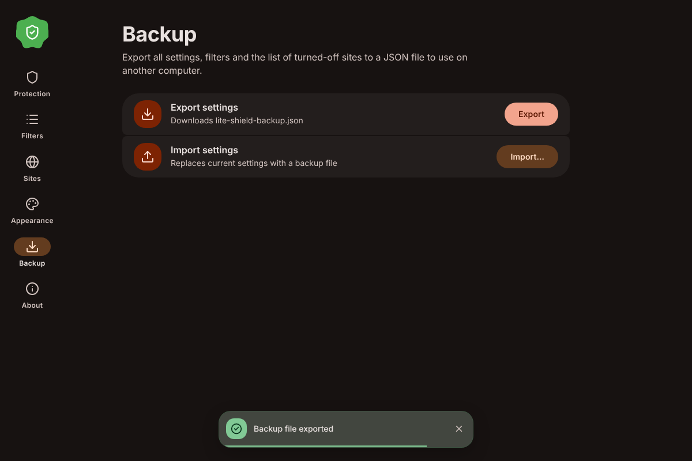

# Lite Shield

**Tiện ích chặn quảng cáo & theo dõi gọn nhẹ, ưu tiên quyền riêng tư cho Chrome (Manifest V3) — thiết kế theo Material 3 Expressive.**

Tiếng Việt · [English](README.md)

Lite Shield là bản làm lại theo ý cá nhân của [uBlock Origin Lite](https://github.com/uBlockOrigin/uBOL-home): chặn bằng engine `declarativeNetRequest` của Chrome nên không đọc lưu lượng mạng của trang và không cần tiến trình nền chạy liên tục. Giao diện được viết lại hoàn toàn theo Material 3 Expressive — màu động, hình khối biến đổi theo lò xo và nhiều chuyển động nhỏ có chủ đích.

  
  

## Tính năng

**Bảo vệ**
- Chặn mạng bằng EasyList + EasyPrivacy biên dịch sang ruleset DNR tĩnh (Quảng cáo, Theo dõi, Gây phiền).
- Ẩn phần tử (cosmetic) chung và theo từng trang, có bộ kiểm tra selector chặt.
- Scriptlet cho quảng cáo YouTube (có thể tắt).
- **Ẩn phần tử thủ công** — chọn bất kỳ phần tử nào để ẩn vĩnh viễn (`Alt+Shift+X` hoặc menu chuột phải).
- **Nhật ký chặn** của tab hiện tại, cho phép từng tên miền chỉ với một cú bấm.
- Bật/tắt theo từng trang, bộ lọc riêng (cú pháp ABP/uBO) có báo lỗi theo dòng.
- Tự động cập nhật danh sách theo lịch hoặc theo yêu cầu; thống kê số lượt chặn.
- Sao lưu / khôi phục toàn bộ cài đặt bằng một file JSON.

**Cá nhân hóa** (Cài đặt → Giao diện)

| Tuỳ chọn | Lựa chọn |
|---|---|
| Chế độ | Sáng · Tối · Hệ thống (hiệu ứng loang tròn khi đổi) |
| Màu chủ đề | 19 màu Material — Red, Pink, Purple, Deep Purple, Indigo, Blue, Light Blue, Cyan, Teal, **Green (mặc định)**, Light Green, Lime, Yellow, Amber, Orange, Deep Orange, Brown, Grey, Blue Grey |
| Cỡ chữ | Nhỏ · Vừa · Lớn |
| Ngôn ngữ | Tiếng Việt · English |
| Font chữ | Hệ thống (mặc định) · Google Sans Flex · Roboto Flex · Roboto · Arial · Inter · Be Vietnam Pro |

Bảng màu sáng/tối được sinh từ màu đã chọn trong không gian OKLCH; cả 19 màu đều giữ độ tương phản ≥ 4,5 : 1 cho mọi cặp chữ/nền ở cả hai chế độ. Font được đóng gói sẵn nên dùng được khi ngoại tuyến.

  
  

**Chi tiết giao diện**
- Dropdown tuỳ biến (ARIA combobox/listbox), giới hạn chiều cao + cuộn, hỗ trợ bàn phím, đổi theo sáng/tối.
- Accordion cho các mục nhiều lựa chọn (màu sắc, xem trước, ghi công).
- Toast 4 biến thể (`info`, `success`, `warning`, `error`) cho cả hai chế độ, chỉ dùng cho kết quả quan trọng: lưu bộ lọc, cập nhật danh sách, sao lưu, lỗi. Công tắc và danh sách phản hồi ngay tại chỗ; nhập sai được báo ngay dưới ô nhập.
- Tooltip tuỳ biến cho nút biểu tượng (khi rê chuột và khi focus bàn phím).
- Nút cuộn lên đầu trang có vòng tiến độ, cuộn mượt.
- Ripple, biến đổi hình khối kiểu lò xo, hiện dần khi cuộn, bộ đếm động; tôn trọng `prefers-reduced-motion`.
- Toàn bộ biểu tượng dùng Lucide.

## Cài đặt (chế độ nhà phát triển)

1. Tải hoặc clone thư mục này.
2. Mở `chrome://extensions`, bật **Chế độ nhà phát triển**.
3. Chọn **Tải tiện ích đã giải nén** và trỏ tới thư mục chứa `manifest.json`.
4. Ghim tiện ích; đặt phím tắt tại `chrome://extensions/shortcuts` nếu muốn.

## Quyền truy cập

| Quyền | Mục đích |
|---|---|
| `declarativeNetRequest`, `declarativeNetRequestFeedback` | Chặn yêu cầu; hiển thị nhật ký và bộ đếm |
| `storage` | Lưu cài đặt và bộ lọc (chỉ trên máy) |
| `scripting`, `activeTab`, `<all_urls>` | Chèn CSS ẩn phần tử, công cụ chọn phần tử và scriptlet YouTube |
| `webRequest`, `webNavigation` | Nhận biết yêu cầu bị chặn cho nhật ký/huy hiệu (chỉ đọc) |
| `alarms` | Cập nhật danh sách theo lịch |
| `contextMenus` | Mục menu “Ẩn một phần tử” |

Không có phân tích dữ liệu, không tải mã từ xa. Yêu cầu mạng duy nhất là cập nhật danh sách lọc (tuỳ chọn) từ GitHub.

## Cấu trúc & phát triển

Xem phần *Project structure* và *Development* trong [README.md](README.md). Thêm ngôn ngữ: sao chép `shared/lang/en.js` thành `shared/lang/<mã>.js`, dịch rồi đăng ký trong `shared/i18n.js`.

## Ghi công

Thiết kế và xây dựng bởi **minhtrong67**, với sự hỗ trợ của AI **Claude** (Anthropic).
Mã nguồn: <https://github.com/minhtrong67/my-chrome-extensions>

Lấy cảm hứng từ uBlock Origin Lite (mã viết mới hoàn toàn). Danh sách lọc © tác giả EasyList. Icon: [Lucide](https://lucide.dev) (ISC). Font: SIL OFL 1.1. Chi tiết trong [THIRD_PARTY.md](THIRD_PARTY.md).
