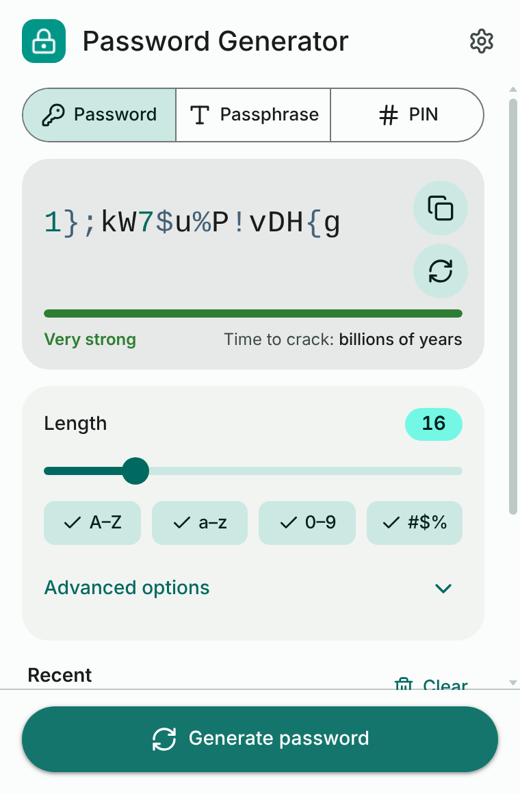
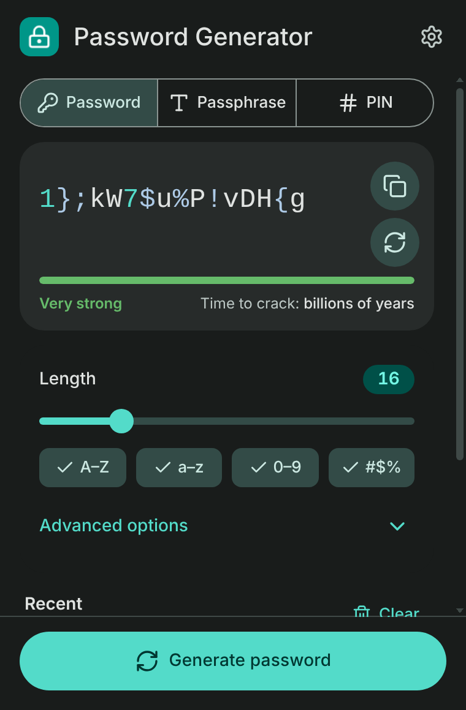
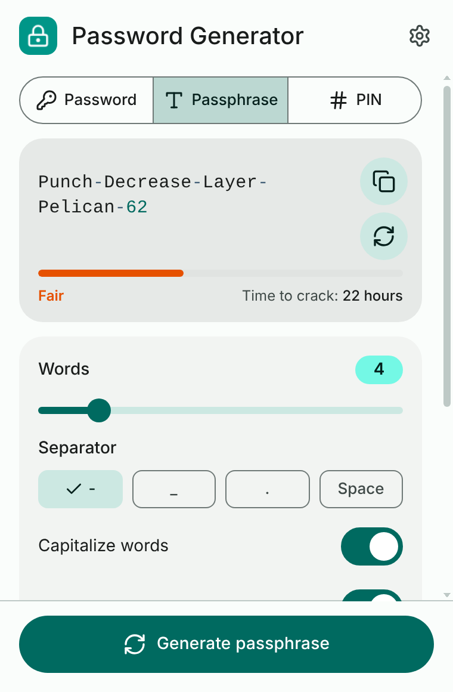
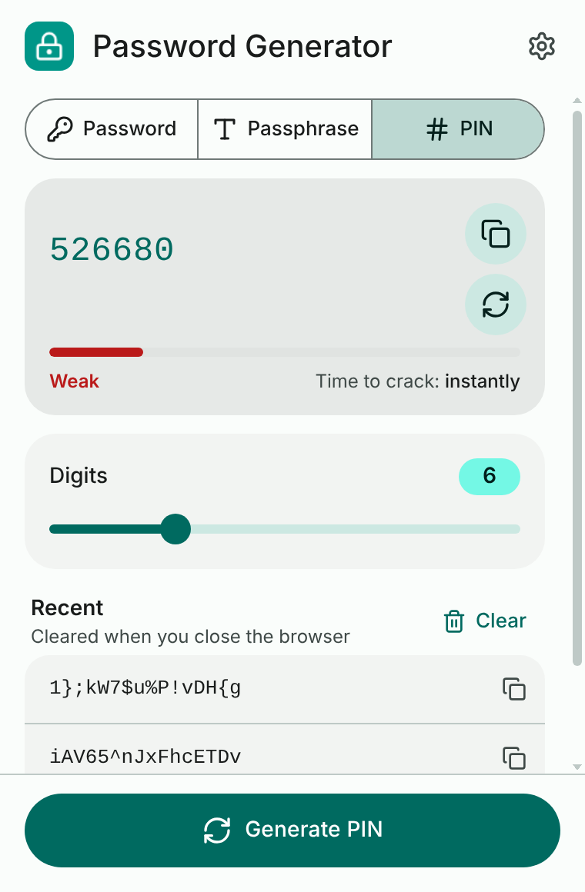
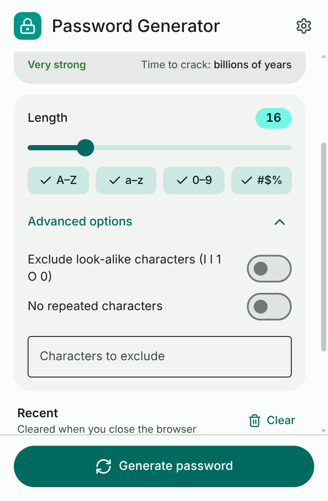
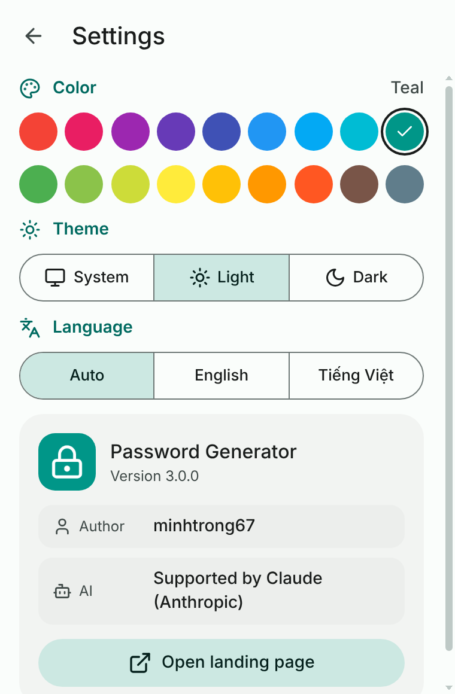
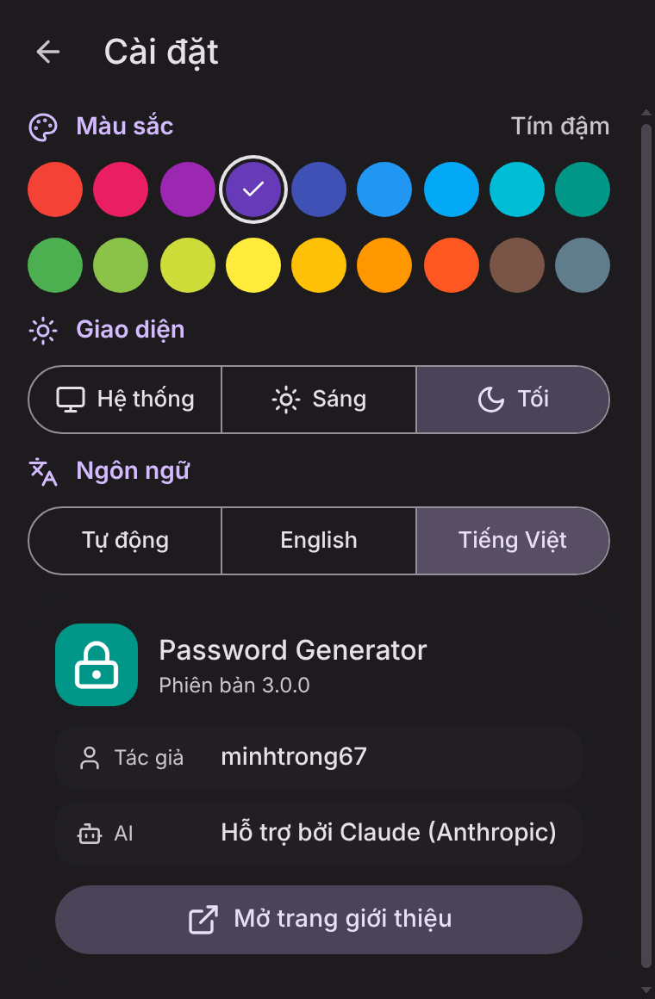
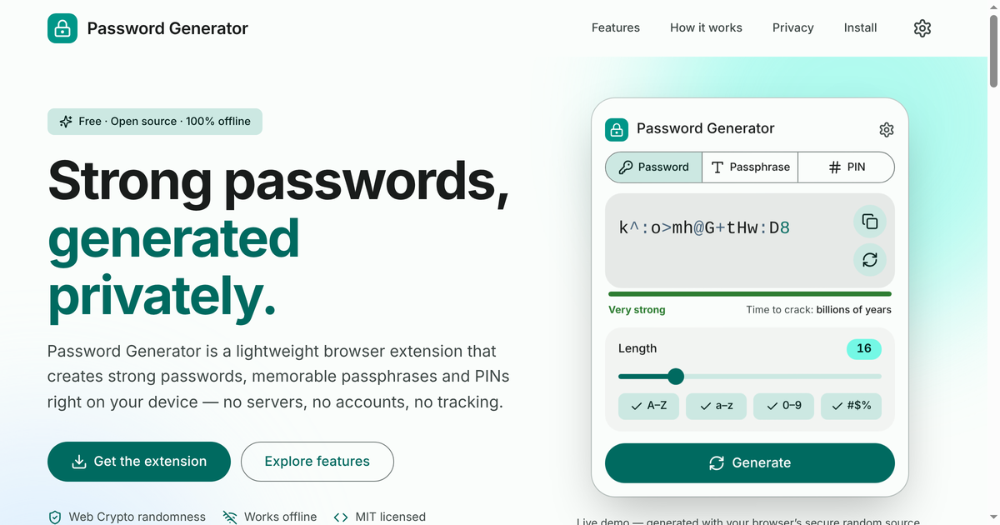
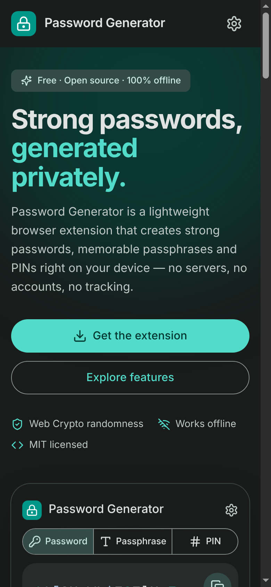
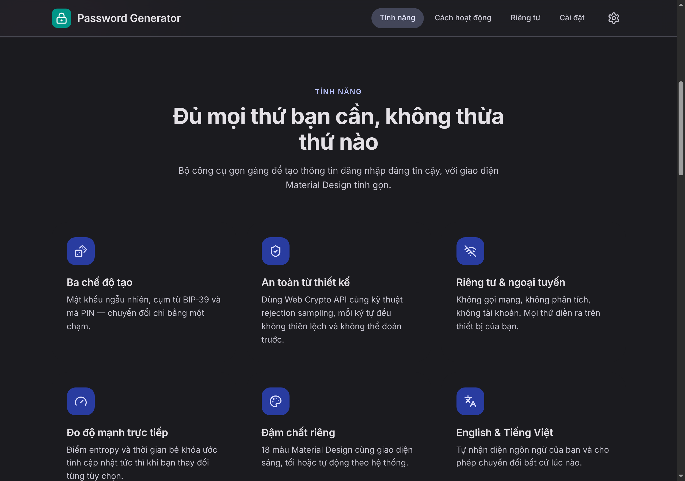

<div align="center">


# Password Generator

**Secure, offline password, passphrase & PIN generator for Chromium browsers.**

Material Design 3 · Lucide icons · Light / Dark / System · English & Tiếng Việt

[](manifest.json)
[](#privacy--security)
[](#tech-stack)
[](LICENSE)

[Tiếng Việt](README.vi.md) · [Landing page](index.html)

</div>

---

## Overview

**Password Generator** is a free, open-source extension for Chrome, Edge, Brave, Opera and other Chromium browsers. It creates strong passwords, memorable passphrases and numeric PINs entirely on your device using the Web Crypto API. No server, no account, no analytics — the extension only requests the `storage` permission to remember your preferences.

> Author: **minhtrong67** · Built with support from **Claude** (AI by Anthropic).

## Screenshots

<table>
  <tr>
    <td align="center"><br /><sub>Password · Light</sub></td>
    <td align="center"><br /><sub>Password · Dark</sub></td>
    <td align="center"><br /><sub>Passphrase</sub></td>
  </tr>
  <tr>
    <td align="center"><br /><sub>PIN</sub></td>
    <td align="center"><br /><sub>Advanced options</sub></td>
    <td align="center"><br /><sub>Settings</sub></td>
  </tr>
  <tr>
    <td align="center"><br /><sub>Settings · Dark · Tiếng Việt</sub></td>
    <td align="center" colspan="2"><br /><sub>Landing page (desktop)</sub></td>
  </tr>
  <tr>
    <td align="center"><br /><sub>Landing page (mobile · dark)</sub></td>
    <td align="center" colspan="2"><br /><sub>Landing page · Vietnamese · Indigo</sub></td>
  </tr>
</table>

## Features

- **Three generators** — random passwords (4–64 characters), BIP‑39 passphrases (3–10 words) and PINs (4–12 digits).
- **Fine control** — character groups, look-alike exclusion (`I l 1 O 0`), no repeated characters and a custom exclusion list. Every enabled group is guaranteed to appear.
- **Live strength meter** — entropy computed from the real character pool, five levels and an estimated time to crack (10 billion guesses/s).
- **Cryptographically secure** — `crypto.getRandomValues()` with rejection sampling and Fisher–Yates shuffling; `Math.random()` is never used.
- **Material Design 3** — tonal surfaces, state layers, segmented buttons, chips, switches and smooth motion; respects *reduced motion*.
- **Compact settings page** (opens inside the popup, no new tab):
  - **Color** — 18 Material Design colors (Red … Blue Grey) with a full M3 tonal palette generated for each.
  - **Theme** — Light, Dark or System (follows the OS automatically).
  - **Language** — English, Tiếng Việt or Auto (detected from the browser).
  - **About** — author, AI credit and a button that opens the bundled landing page in a new tab.
- **Recent history** — kept in session storage only and wiped when the browser closes; anything you copy is saved so you never lose it.
- **Landing page** — one self-contained `index.html` with SEO and social meta tags, scroll animations, a live demo, theme/color/language switchers and full responsiveness.

## Installation

1. Download or clone this repository.
2. Open `chrome://extensions` (Edge: `edge://extensions`, Brave: `brave://extensions`).
3. Enable **Developer mode**.
4. Click **Load unpacked** and choose the folder that contains `manifest.json`.
5. Pin **Password Generator** to the toolbar.

## Usage

1. Choose **Password**, **Passphrase** or **PIN**.
2. Tune the options — the result and strength meter update live.
3. Press **Generate** (or the refresh icon) for a new value, then **Copy**.
4. Open **Settings** (gear icon) to change color, theme or language.

## Privacy & security

| | |
|---|---|
| Permissions | `storage` only — no host permissions, no tabs, no content scripts |
| Network | None. No requests, telemetry or remote code |
| Settings | `chrome.storage.local` |
| History | `chrome.storage.session` — memory only, cleared when the browser closes |
| Randomness | `crypto.getRandomValues()` + rejection sampling (no modulo bias) |
| Passphrases | BIP‑39 English wordlist, 2,048 words (11 bits per word) |

## Tech stack

| Area | Technology |
|---|---|
| Platform | Chrome Extension, Manifest V3 |
| UI | Semantic HTML, CSS custom properties, Material Design 3 |
| Icons | [Lucide](https://lucide.dev) (inline SVG, bundled — works offline) |
| Typography | Platform default system font stack |
| Colors | Tonal palettes generated with `@material/material-color-utilities` |
| Logic | Vanilla JavaScript (ES2020), no framework, no bundler |

## Project structure

```text
.
├── manifest.json        # MV3 manifest (landing page registered as a sandbox page)
├── popup.html           # Popup: generator + settings view
├── index.html           # Landing page (single file: HTML + CSS + JS)
├── css/
│   ├── colors.css       # Material 3 tokens for 18 colors × light/dark
│   └── popup.css        # Popup components and motion
├── js/
│   ├── boot.js          # Applies theme before first paint
│   ├── icons.js         # Bundled Lucide icons
│   ├── i18n.js          # English / Vietnamese strings, language detection
│   ├── storage.js       # Settings (local) and history (session)
│   ├── theme.js         # Theme / color helpers
│   ├── generator.js     # Secure password, passphrase and PIN logic
│   ├── wordlist.js      # BIP‑39 wordlist
│   └── main.js          # UI controller
├── icons/               # Extension icons (16/32/48/128 px) + source SVG, color #009688
├── _locales/            # Extension name & description (en, vi)
└── screenshots/         # image01.png … image10.png
```

## Landing page

`index.html` sits in the project root. Inside the extension, **Settings → Open landing page** opens it in a new tab through `chrome.runtime.getURL("index.html")` — no deployed URL is needed — and passes the current theme, color and language in the URL hash so both pages match. It is registered as a `sandbox` page in the manifest so its inline script can run under Manifest V3’s CSP.

To publish it on the web, serve the repository root (for example with GitHub Pages) and update the `canonical`, `og:url`, `og:image` and `twitter:image` URLs in the `<head>` of `index.html` (they currently assume `https://minhtrong67.github.io/password-generator/`).

## Development

There is nothing to build. Edit the files, then press **Reload** on the extensions page.

```bash
# Preview the landing page locally
python3 -m http.server 8000      # then open http://localhost:8000/

# Syntax check
for f in js/*.js; do node --check "$f"; done
```

Debug the popup via right-click on the toolbar icon → **Inspect popup**.

To package a release:

```bash
zip -r password-generator-3.0.0.zip manifest.json popup.html index.html css js icons _locales
```

## Credits

- Author: **minhtrong67**
- Built with the support of **Claude** by Anthropic
- Icons: [Lucide](https://lucide.dev) (ISC) · Wordlist: [BIP‑39](https://github.com/bitcoin/bips/blob/master/bip-0039/english.txt)

## License

Released under the [MIT License](LICENSE).
