<div align="center">


# Photo Converter

**Convert images to PNG, JPEG & WEBP in one click.**
Right-click convert · Batch to `.zip` · Resize & quality · 100% offline


[English](#-english) · [Tiếng Việt](#-tiếng-việt)

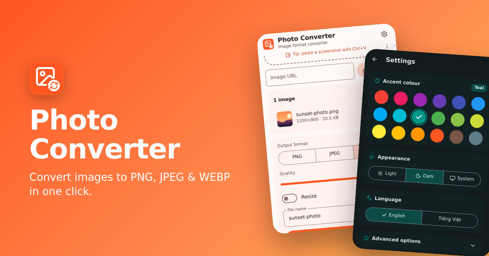

</div>

---

## 🇬🇧 English

### Overview

Photo Converter is a fast, private Chrome extension for converting images between **PNG, JPEG and WEBP**. Right-click any image on the web, or open the popup to drop in your own files and convert them one by one or as a batch. Everything runs locally in your browser — no uploads, no accounts, no tracking.

Designed with **Material Design**, the system font and **[Lucide](https://lucide.dev) icons**, with 18 Material accent colours, light / dark / system themes and automatic English / Vietnamese language detection.

### Screenshots

| | | |
|:---:|:---:|:---:|
| 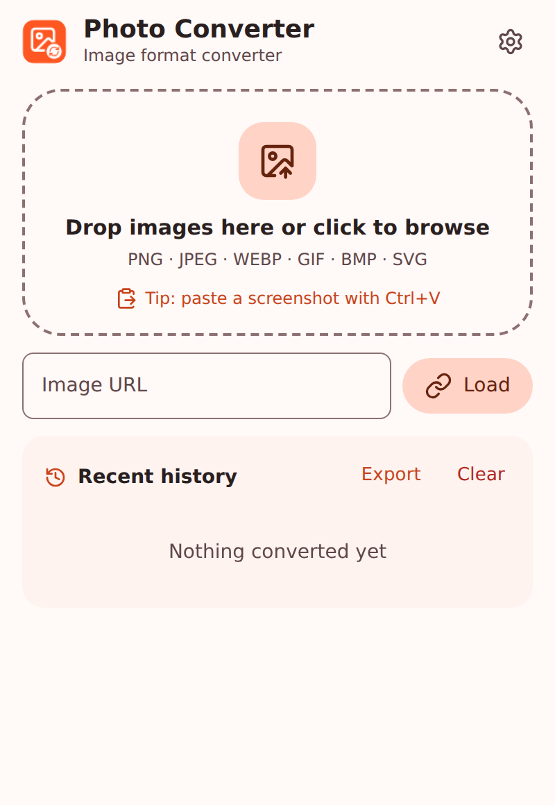<br/>**Home** | 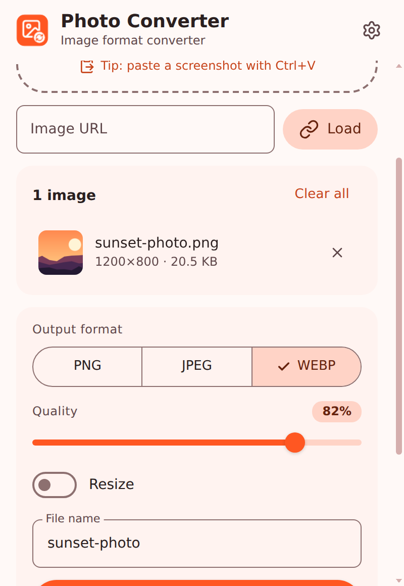<br/>**Options** | 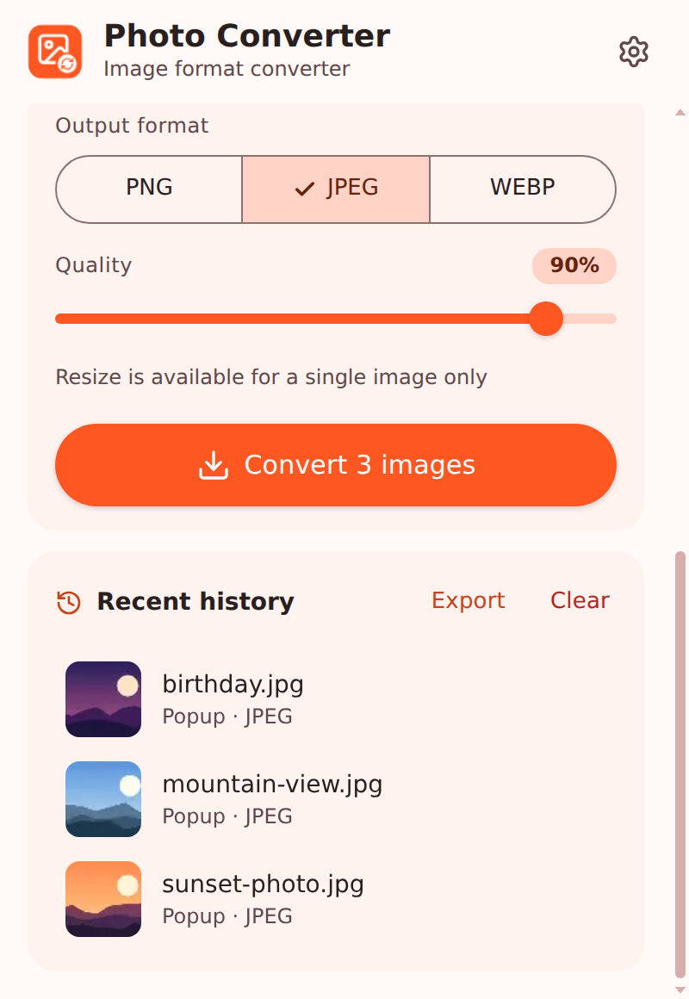<br/>**Batch & history** |
| 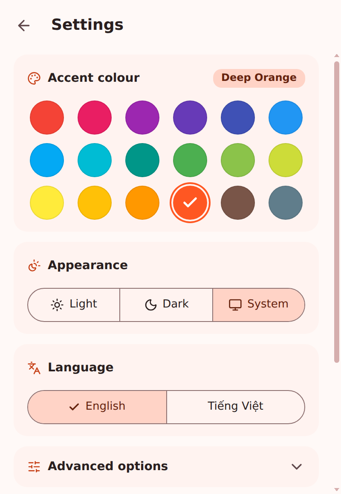<br/>**Settings** | 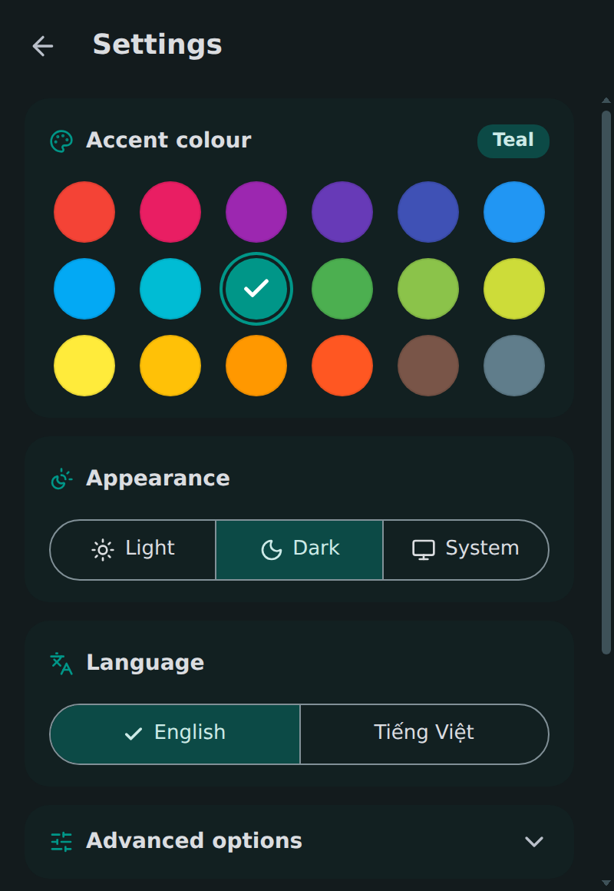<br/>**Dark + Teal** | 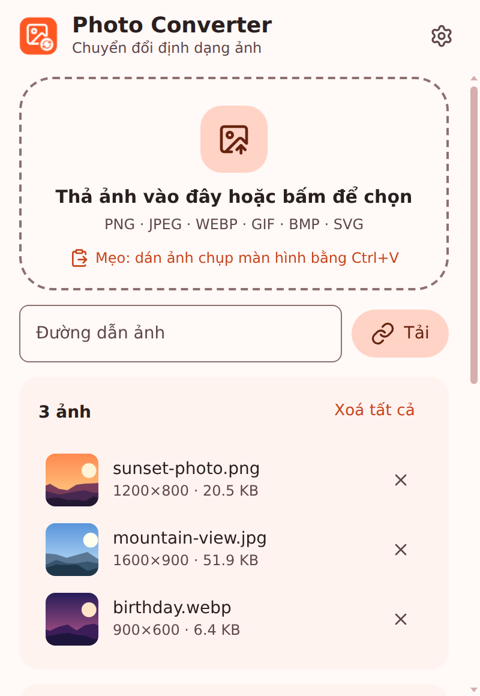<br/>**Vietnamese** |
| 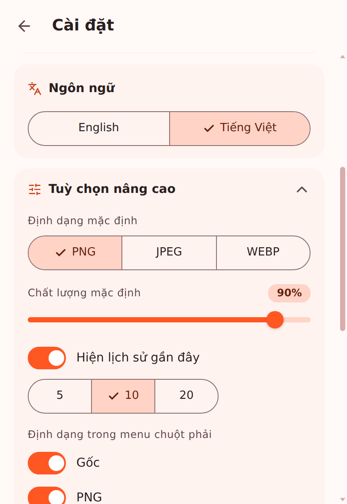<br/>**Advanced options** | | |

**Landing page** (`index.html`)

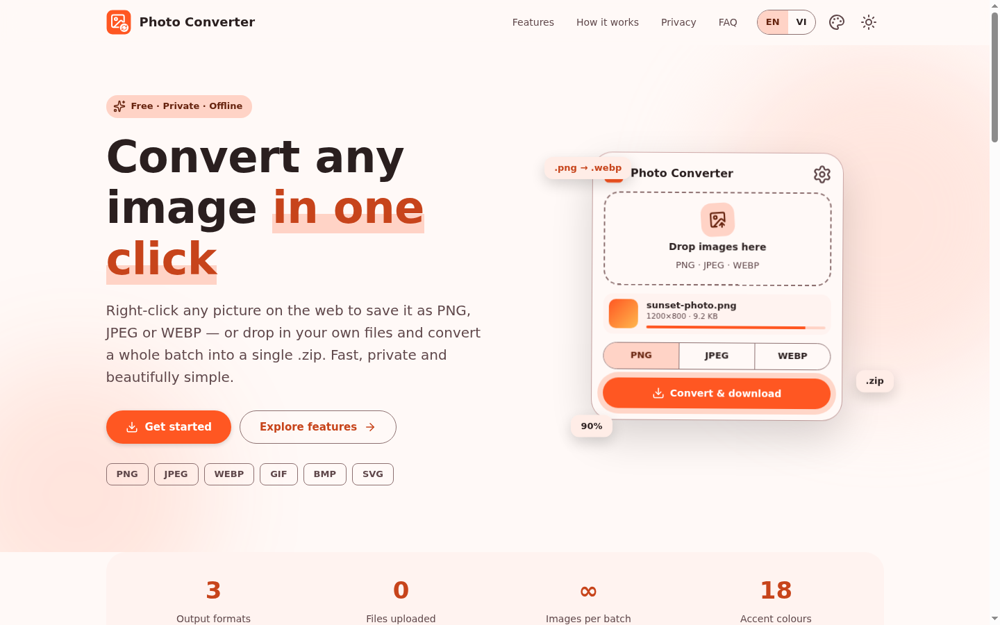

| Dark theme · Vietnamese | Mobile |
|:---:|:---:|
| 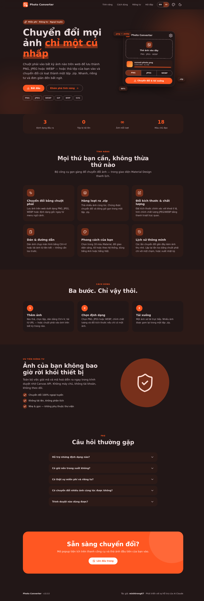 | 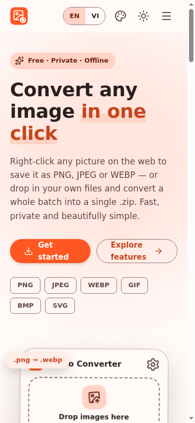 |

### Features

- 🖱️ **Right-click convert** — save any web image as PNG, JPEG, WEBP or its original format from the context menu.
- 📦 **Batch conversion** — convert many images at once; results are bundled into a single `.zip` (UTF-8 file names supported).
- 📐 **Resize** — exact width/height with aspect-ratio lock (single image).
- 🎚️ **Quality control** — live slider for JPEG/WEBP.
- 📋 **Paste & URL** — paste a screenshot with `Ctrl+V` or load an image from a link.
- 🕘 **History** — thumbnails of recent conversions, one-tap "convert again" for right-click saves, export as `.txt`.
- 🎨 **Personalisation** — 18 Material colours, light / dark / system theme, English / Vietnamese (auto-detected).
- 🔒 **Private** — decoding and encoding use the Canvas API locally. Zero network requests besides loading the image you asked for.

### Installation (developer mode)

1. Download or clone this repository and unzip it.
2. Open `chrome://extensions` and enable **Developer mode**.
3. Click **Load unpacked** and select the project folder (the one containing `manifest.json`).
4. Pin **Photo Converter** to the toolbar and click the icon.

> Requires Chrome 116+ (or any Chromium browser with Manifest V3 and offscreen-document support).

### Usage

1. **Right-click** an image → **Save image as** → choose a format. *or*
2. Click the toolbar icon → drop, browse, paste or load images → pick a format → **Convert & download**.
3. Open **Settings** (gear icon) to change colour, theme, language and advanced options.

### Settings

The settings page opens **inside the popup** (no new tab) and is intentionally compact:

| Section | Description |
|---|---|
| Accent colour | 18 Material Design colours, applied instantly to the whole UI |
| Appearance | Light · Dark · System (follows the OS automatically) |
| Language | English · Tiếng Việt (detected from the browser on first run) |
| Advanced options | Default format/quality, history size, right-click menu formats, notifications, export / import / reset |
| About | Version, author, and a button that opens the landing page in a new tab |

### Project structure

```
photo-converter/
├── manifest.json        # Manifest V3
├── popup.html           # Popup UI (converter + settings views)
├── offscreen.html       # Hidden page used for right-click conversions
├── index.html           # Single-file landing page (SEO + social meta tags)
├── css/popup.css        # Material Design styles
├── js/
│   ├── main.js          # Popup logic
│   ├── background.js    # Service worker, context menus, downloads
│   ├── offscreen.js     # Fetch + decode + encode (OffscreenCanvas)
│   ├── i18n.js          # English / Vietnamese strings
│   ├── theme.js         # Material colour scheme generator
│   ├── storage.js       # Settings & history (chrome.storage)
│   └── zip.js           # Dependency-free ZIP writer
├── icons/               # 16 / 32 / 48 / 128 px, colour #FF5722
├── _locales/            # Extension name & description (en, vi)
└── screenshots/         # image01 … image11
```

### Changelog — v3.0.0

**Redesign:** Material Design UI with the system font and Lucide icons; compact settings page (colour, theme, language); new icon (`#FF5722`); new landing page.

**Bug fixes**

- JPEG output of transparent images had a **black background** → now filled with white (popup and right-click).
- Adding or removing an image **reset format, quality and file name** → options are now preserved.
- `.zip` files showed **garbled non-ASCII names** (e.g. Vietnamese) in some tools → UTF-8 flag added.
- Dropping a file **outside the drop zone** navigated the popup away → prevented.
- Drop-zone **flickered** when dragging over child elements → fixed.
- Files with an **empty MIME type** (e.g. some pasted/dragged images) were rejected → decoding is attempted instead.
- Right-click saving of **`data:` URLs** produced a garbage file name → now `image.ext`.
- Right-click menu could be **built twice** concurrently (duplicate-ID error) → rebuilds are serialised.
- Settings **import** accepted arbitrary data → every value is validated and whitelisted.
- Oversized images could crash conversion → dimension/area limits with a clear message.
- Queue/history **tooltips were not translated** after switching language → fixed.

**Performance**

- Right-click conversion returns a `blob:` URL instead of a base64 data URL (less memory, faster).
- One canvas is reused for every conversion; the UI yields between batch items and shows progress.
- History is written once per batch instead of once per image; thumbnails use WEBP.
- Queue list updates by diff (no flicker, no re-animation).

### Credits

- **Author:** [`minhtrong67`](#)
- **Built with the help of AI:** Claude (Anthropic)
- Icons by [Lucide](https://lucide.dev) (ISC license).

---

## 🇻🇳 Tiếng Việt

### Giới thiệu

Photo Converter là tiện ích Chrome nhanh và riêng tư để chuyển đổi ảnh giữa **PNG, JPEG và WEBP**. Chuột phải vào ảnh bất kỳ trên web, hoặc mở popup để thả tệp của bạn vào và chuyển đổi từng ảnh hay cả loạt. Mọi thứ chạy ngay trong trình duyệt — không tải lên, không tài khoản, không theo dõi.

Thiết kế theo **Material Design**, dùng font mặc định của hệ thống và bộ icon **[Lucide](https://lucide.dev)**, với 18 màu chủ đạo Material, giao diện sáng / tối / theo hệ thống và tự nhận diện ngôn ngữ Anh / Việt.

### Ảnh chụp màn hình

Xem bộ ảnh ở phần [Screenshots](#screenshots) phía trên (thư mục `screenshots/`, đặt tên `image01`, `image02`, …).

### Tính năng

- 🖱️ **Chuyển đổi bằng chuột phải** — lưu ảnh web thành PNG, JPEG, WEBP hoặc định dạng gốc từ menu ngữ cảnh.
- 📦 **Chuyển đổi hàng loạt** — nhiều ảnh cùng lúc, đóng gói thành một tệp `.zip` (hỗ trợ tên tệp tiếng Việt có dấu).
- 📐 **Đổi kích thước** — nhập chính xác rộng/cao, khoá tỉ lệ khung hình (với một ảnh).
- 🎚️ **Chỉnh chất lượng** — thanh trượt trực quan cho JPEG/WEBP.
- 📋 **Dán & đường dẫn** — dán ảnh chụp màn hình bằng `Ctrl+V` hoặc tải ảnh từ liên kết.
- 🕘 **Lịch sử** — ảnh thu nhỏ của các lần chuyển đổi gần đây, "chuyển đổi lại" bằng một chạm, xuất ra `.txt`.
- 🎨 **Cá nhân hoá** — 18 màu Material, giao diện sáng / tối / hệ thống, tiếng Anh / tiếng Việt (tự nhận diện).
- 🔒 **Riêng tư** — giải mã và mã hoá cục bộ bằng Canvas API. Không có yêu cầu mạng nào ngoài việc tải ảnh bạn yêu cầu.

### Cài đặt (chế độ nhà phát triển)

1. Tải hoặc clone kho mã này rồi giải nén.
2. Mở `chrome://extensions` và bật **Chế độ nhà phát triển**.
3. Chọn **Tải tiện ích đã giải nén** và trỏ tới thư mục dự án (thư mục chứa `manifest.json`).
4. Ghim **Photo Converter** lên thanh công cụ và bấm vào biểu tượng.

> Yêu cầu Chrome 116 trở lên (hoặc trình duyệt Chromium hỗ trợ Manifest V3 và offscreen document).

### Cách dùng

1. **Chuột phải** vào ảnh → **Lưu ảnh dưới dạng** → chọn định dạng. *hoặc*
2. Bấm biểu tượng tiện ích → thả, chọn, dán hoặc tải ảnh → chọn định dạng → **Chuyển đổi & tải xuống**.
3. Mở **Cài đặt** (biểu tượng bánh răng) để đổi màu, giao diện, ngôn ngữ và các tuỳ chọn nâng cao.

### Cài đặt trong ứng dụng

Trang cài đặt mở **ngay trong popup** (không mở tab mới) và được rút gọn:

| Mục | Mô tả |
|---|---|
| Màu chủ đạo | 18 màu Material Design, áp dụng tức thì cho toàn bộ giao diện |
| Giao diện | Sáng · Tối · Hệ thống (tự theo hệ điều hành) |
| Ngôn ngữ | English · Tiếng Việt (tự nhận diện từ trình duyệt ở lần đầu) |
| Tuỳ chọn nâng cao | Định dạng/chất lượng mặc định, số mục lịch sử, định dạng menu chuột phải, thông báo, xuất / nhập / khôi phục |
| Giới thiệu | Phiên bản, tác giả và nút mở trang landing page trong tab mới |

### Nhật ký thay đổi — v3.0.0

**Thiết kế lại:** giao diện Material Design với font hệ thống và icon Lucide; trang cài đặt gọn gàng (màu, giao diện, ngôn ngữ); icon mới (`#FF5722`); landing page mới.

**Sửa lỗi**

- Ảnh trong suốt chuyển sang JPEG bị **nền đen** → nay tô nền trắng (popup và chuột phải).
- Thêm/xoá ảnh làm **mất định dạng, chất lượng, tên tệp** đã chọn → nay giữ nguyên.
- Tệp `.zip` bị **lỗi font tên tệp** (tiếng Việt có dấu) trên một số công cụ → thêm cờ UTF-8.
- Thả tệp **ngoài vùng thả** làm popup chuyển sang tệp đó → đã chặn.
- Vùng thả **nhấp nháy** khi kéo qua phần tử con → đã sửa.
- Tệp **không có MIME type** (một số ảnh dán/kéo) bị từ chối → nay vẫn thử giải mã.
- Lưu ảnh **`data:` URL** bằng chuột phải ra tên tệp rác → nay là `image.ext`.
- Menu chuột phải có thể **tạo trùng lặp** (lỗi trùng ID) → các lần dựng lại được xếp hàng tuần tự.
- **Nhập** cài đặt chấp nhận dữ liệu tuỳ ý → mọi giá trị đều được kiểm tra.
- Ảnh quá lớn có thể làm hỏng chuyển đổi → giới hạn kích thước kèm thông báo rõ ràng.
- Tooltip trong danh sách **không được dịch** khi đổi ngôn ngữ → đã sửa.

**Hiệu năng**

- Chuyển đổi chuột phải trả về `blob:` URL thay vì base64 (nhẹ và nhanh hơn).
- Dùng lại một canvas cho mọi lần chuyển đổi; giao diện nhường luồng giữa các ảnh và hiện tiến trình.
- Ghi lịch sử một lần cho cả loạt thay vì từng ảnh; ảnh thu nhỏ dùng WEBP.
- Danh sách ảnh cập nhật theo khác biệt (không nhấp nháy, không chạy lại hiệu ứng).

### Ghi công

- **Tác giả:** `minhtrong67`
- **Phát triển với sự hỗ trợ của AI:** Claude (Anthropic)
- Icon bởi [Lucide](https://lucide.dev) (giấy phép ISC).

---

<div align="center"><sub>Made by <b>minhtrong67</b> with the help of Claude AI · v3.0.0</sub></div>
