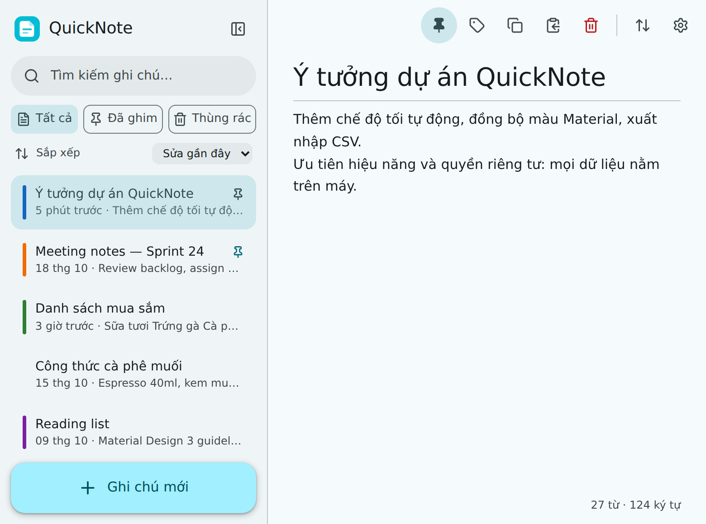
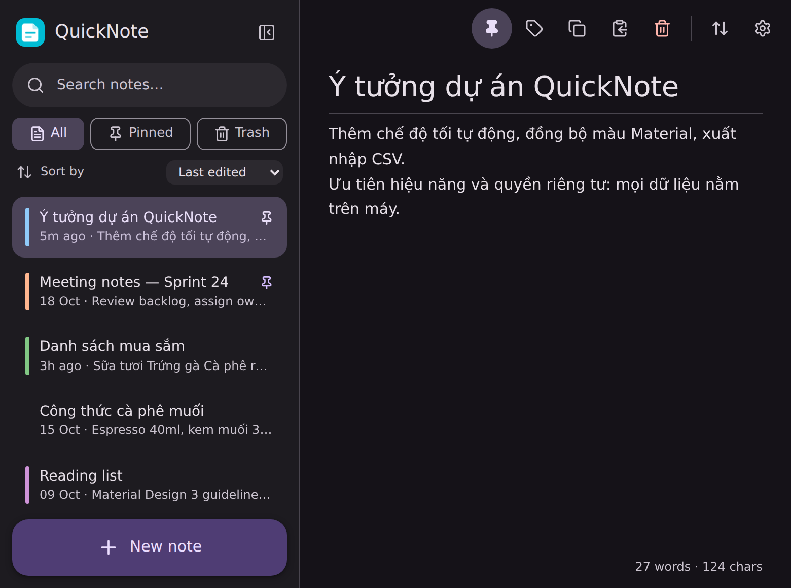
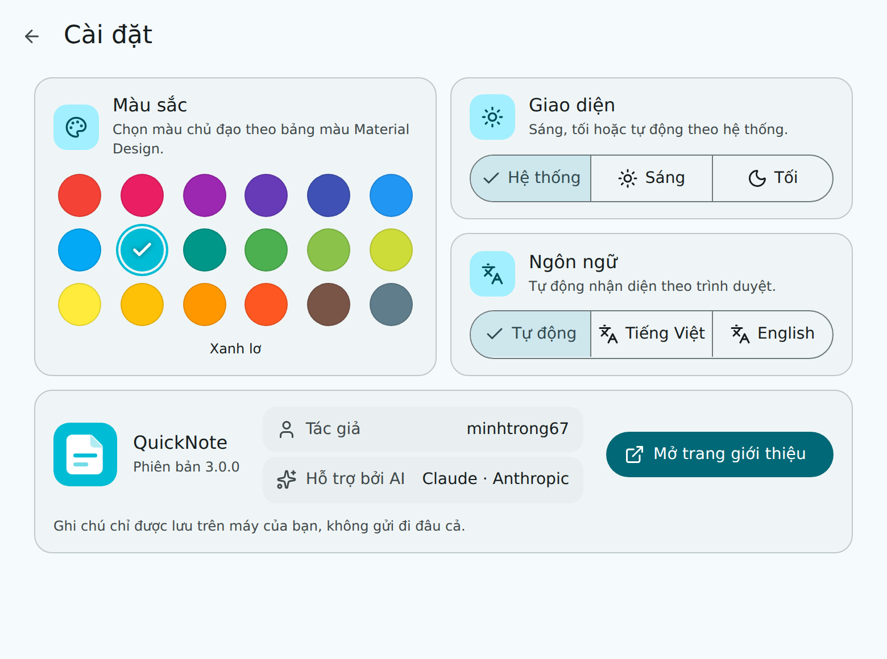
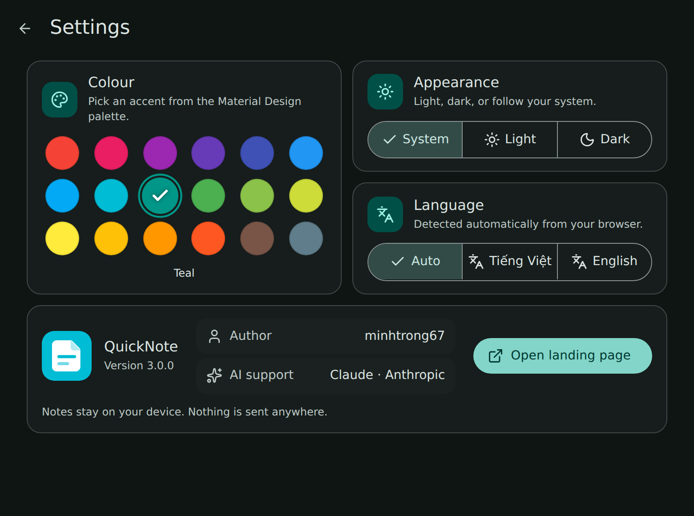
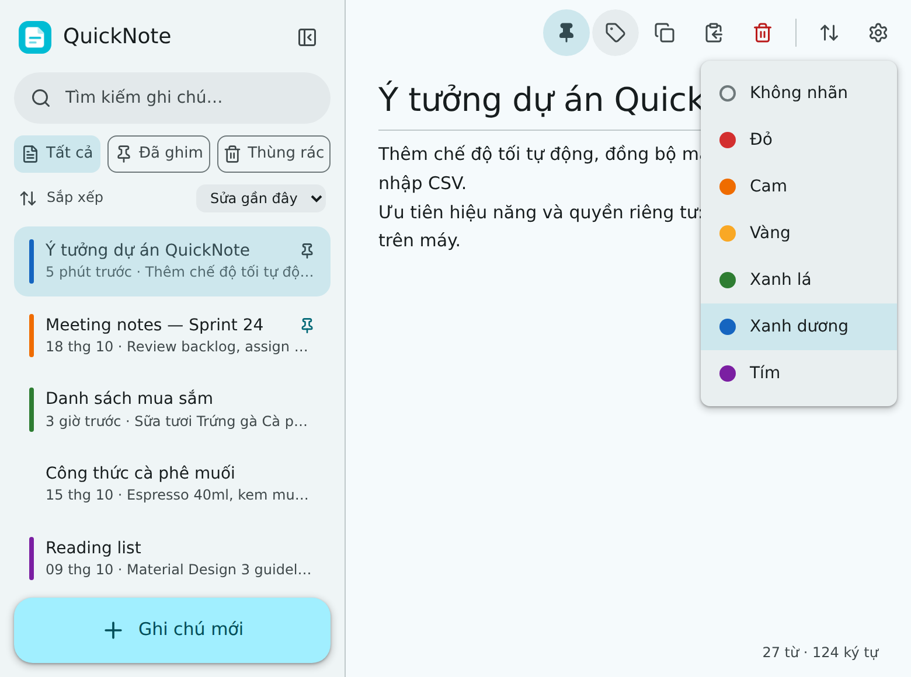
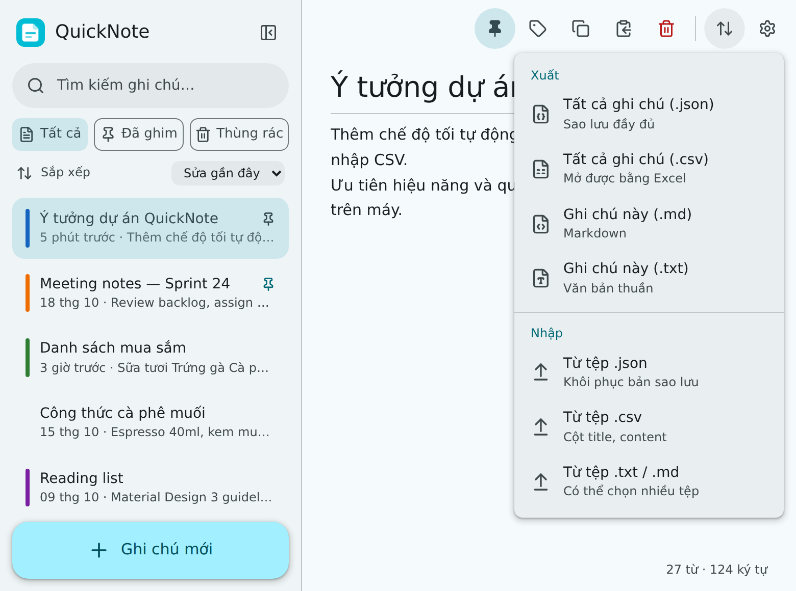
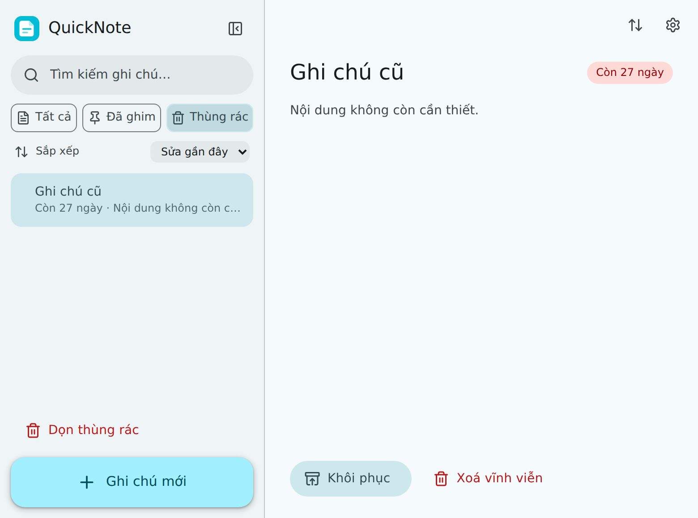
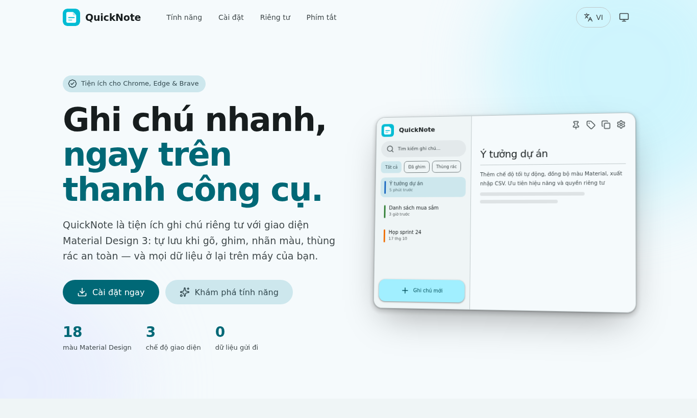
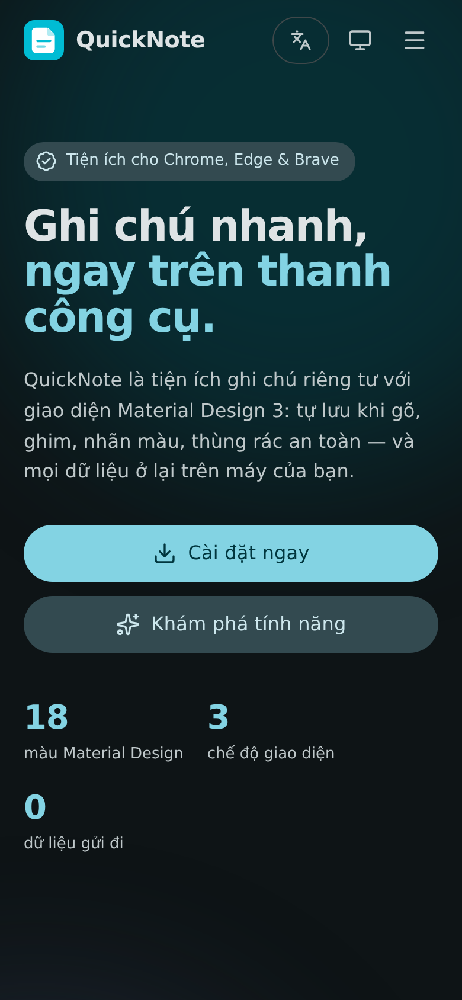

<div align="center">


# QuickNote

**Ghi chú nhanh, riêng tư, chuẩn Material Design 3**<br />
**Fast, private notes in Material Design 3**

    

[Tính năng · Features](#-tính-năng--features) ·
[Ảnh chụp · Screenshots](#-ảnh-chụp--screenshots) ·
[Cài đặt · Install](#-cài-đặt--installation) ·
[Phím tắt · Shortcuts](#-phím-tắt--shortcuts) ·
[Cấu trúc · Structure](#-cấu-trúc-dự-án--project-structure)



</div>

> 🇻🇳 Mỗi mục có **Tiếng Việt** trước, **English** sau. · 🇬🇧 Every section is **Vietnamese** first, **English** second.

## ✨ Tính năng · Features

| | Tiếng Việt | English |
|---|---|---|
| ⚡ | Mở tức thì bằng biểu tượng hoặc `Alt+Shift+N`, **tự lưu khi gõ** và không mất dữ liệu khi popup đóng đột ngột | Opens instantly, **autosaves as you type** and never loses edits when the popup closes |
| 🎨 | Giao diện **Material Design 3** với **18 màu** chủ đạo; bảng màu sáng/tối được sinh tự động | **Material Design 3** UI with **18 accent colours**; light/dark palettes generated automatically |
| 🌗 | Giao diện **Sáng / Tối / Theo hệ thống** | **Light / Dark / System** appearance |
| 🌐 | **Tiếng Việt & English**, tự nhận diện ngôn ngữ trình duyệt | **Vietnamese & English**, auto-detected from the browser |
| 📌 | Ghim ghi chú, 6 nhãn màu | Pin notes, 6 colour labels |
| 🔎 | Tìm kiếm **không dấu** ("ca phe" → "cà phê"), sắp xếp theo ngày sửa/tạo/A–Z | **Accent-insensitive** search, sort by edited/created/A–Z |
| 🗑️ | Thùng rác 30 ngày + nút **Hoàn tác** | 30-day trash with an **Undo** action |
| 📤 | Nhập/xuất `.json`, `.csv`, `.md`, `.txt` | Import/export `.json`, `.csv`, `.md`, `.txt` |
| ⚙️ | Trang **Cài đặt gọn**: màu sắc · giao diện · ngôn ngữ · giới thiệu — mở ngay trong popup, không cần tab mới | **Compact Settings**: colour · appearance · language · about — opens inside the popup, no new tab |
| 🔒 | Dữ liệu chỉ lưu trên máy, chạy hoàn toàn offline, không font/script ngoài | Data stays on-device, fully offline, no external fonts/scripts |
| 🌍 | Có sẵn **landing page** một file (`landing.html`) | Ships with a single-file **landing page** (`landing.html`) |

Font dùng **font mặc định của hệ thống** (`system-ui`); icon dùng **[Lucide](https://lucide.dev)** (đóng gói cục bộ).<br />
The UI uses the **system default font** (`system-ui`); icons are **[Lucide](https://lucide.dev)** (bundled locally).

## 🖼️ Ảnh chụp · Screenshots

| | |
|---|---|
| <br />**Giao diện chính (sáng) · Main window (light)** | <br />**Chế độ tối, màu Deep Purple · Dark mode, Deep Purple** |
| <br />**Cài đặt (trong popup) · Settings (inside the popup)** | <br />**Đổi màu Teal · Switching to Teal** |
| <br />**Nhãn màu · Colour labels** | <br />**Nhập / xuất · Import / export** |
| <br />**Thùng rác · Trash** | <br />**Landing page (desktop)** |

<p align="center"><br /><b>Landing page (mobile, dark)</b></p>

## 📦 Cài đặt · Installation

**Tiếng Việt**
1. Giải nén thư mục `quicknote`.
2. Mở `chrome://extensions` (hoặc `edge://extensions`) và bật **Developer mode**.
3. Nhấn **Load unpacked** → chọn thư mục `quicknote`.
4. Ghim biểu tượng QuickNote lên thanh công cụ.

**English**
1. Unzip the `quicknote` folder.
2. Open `chrome://extensions` (or `edge://extensions`) and enable **Developer mode**.
3. Click **Load unpacked** and select the `quicknote` folder.
4. Pin the QuickNote icon to the toolbar.

Yêu cầu / Requires: Chrome, Edge, Brave hoặc trình duyệt Chromium ≥ 105 (Manifest V3).

## ⚙️ Cài đặt trong ứng dụng · In-app settings

Nhấn biểu tượng ⚙️ trên thanh công cụ của popup — bảng cài đặt trượt ra **ngay trong popup**. Cũng có thể mở từ *Details → Extension options* (hiển thị nhúng trong `chrome://extensions`).<br />
Press ⚙️ in the popup toolbar — the settings panel slides in **inside the popup**. It is also available under *Details → Extension options* (embedded in `chrome://extensions`).

- **Màu sắc · Colour** — 18 màu Material (Red … Blue Grey), mặc định Cyan `#00BCD4` · 18 Material colours, default Cyan `#00BCD4`
- **Giao diện · Appearance** — Hệ thống / Sáng / Tối · System / Light / Dark
- **Ngôn ngữ · Language** — Tự động / Tiếng Việt / English · Auto / Vietnamese / English
- **Giới thiệu · About** — tác giả `minhtrong67`, hỗ trợ AI **Claude** (Anthropic); nút **Mở trang giới thiệu** mở `landing.html` trong tab mới (đường dẫn nằm trong mã nguồn, không cần URL deploy) · author `minhtrong67`, AI support **Claude** (Anthropic); the **Open landing page** button opens the bundled `landing.html` in a new tab (no deployment URL needed)

## ⌨️ Phím tắt · Shortcuts

| Phím · Key | Tác vụ · Action |
|---|---|
| `Alt+Shift+N` | Mở QuickNote · Open QuickNote (đổi tại `chrome://extensions/shortcuts`) |
| `Alt+N` | Ghi chú mới · New note |
| `Alt+F` | Tìm kiếm · Search |
| `Alt+P` | Ghim / bỏ ghim · Pin / unpin |
| `Ctrl/⌘+S` | Lưu ngay · Save now |
| `Esc` | Đóng hộp thoại, menu, cài đặt · Close dialog, menu, settings |

## 🗂️ Cấu trúc dự án · Project structure

```text
quicknote/
├── manifest.json        # Manifest V3
├── popup.html/.css/.js  # Danh sách ghi chú, trình soạn thảo, cài đặt trong popup
├── options.html/.js     # Cài đặt nhúng trong chrome://extensions
├── landing.html         # Landing page 1 file (HTML+CSS+JS, SEO + social meta)
├── shared/
│   ├── theme.css        # Token Material 3 + thành phần dùng chung
│   ├── palettes.js      # 18 bảng màu M3 (sinh bằng material-color-utilities)
│   ├── icons.js         # Lucide icons (cục bộ)
│   ├── i18n.js          # Từ điển vi/en
│   ├── settings.js      # Màu · giao diện · ngôn ngữ
│   ├── settings-ui.js   # Màn hình cài đặt dùng chung
│   └── ripple.js        # Hiệu ứng ripple
├── icons/               # Icon #00BCD4 (16–512 px) + icon.svg
└── screenshots/         # image01 … image09, og-cover
```

## 🔒 Quyền riêng tư · Privacy

Chỉ dùng hai quyền `storage` và `unlimitedStorage`. Không có tài khoản, không theo dõi, không yêu cầu mạng.<br />
Only `storage` and `unlimitedStorage` permissions are used. No accounts, no tracking, no network requests.

## 🌐 Landing page

`landing.html` là một file duy nhất, có animation mượt, responsive, đổi giao diện/ngôn ngữ và đầy đủ thẻ meta SEO + Open Graph + Twitter Card + JSON-LD. Khi deploy, hãy đổi `og:image`/`twitter:image` thành URL tuyệt đối và thêm `canonical`.<br />
`landing.html` is a single file with smooth animation, responsive layout, theme/language switching and full SEO + Open Graph + Twitter Card + JSON-LD metadata. When deploying, change `og:image`/`twitter:image` to absolute URLs and add a `canonical` link.

## 📄 Giấy phép · License

MIT — xem [LICENSE](LICENSE).

## 👤 Tác giả · Author

**minhtrong67**, với sự hỗ trợ của AI **Claude** (Anthropic) · with AI support from **Claude** (Anthropic).
