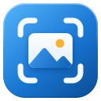
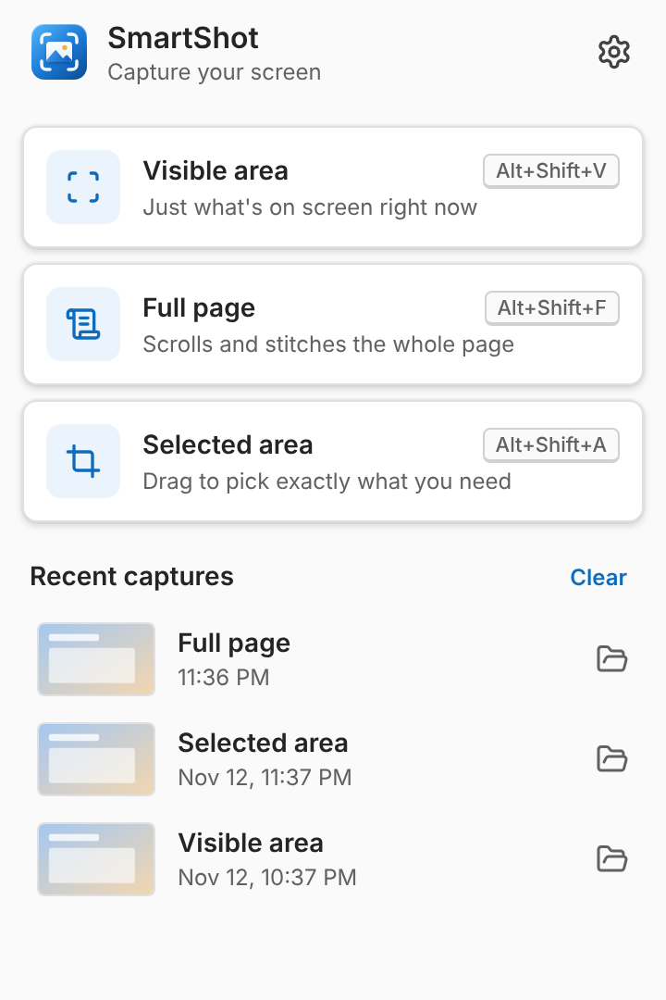
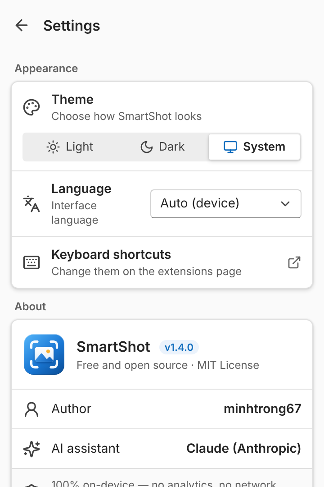
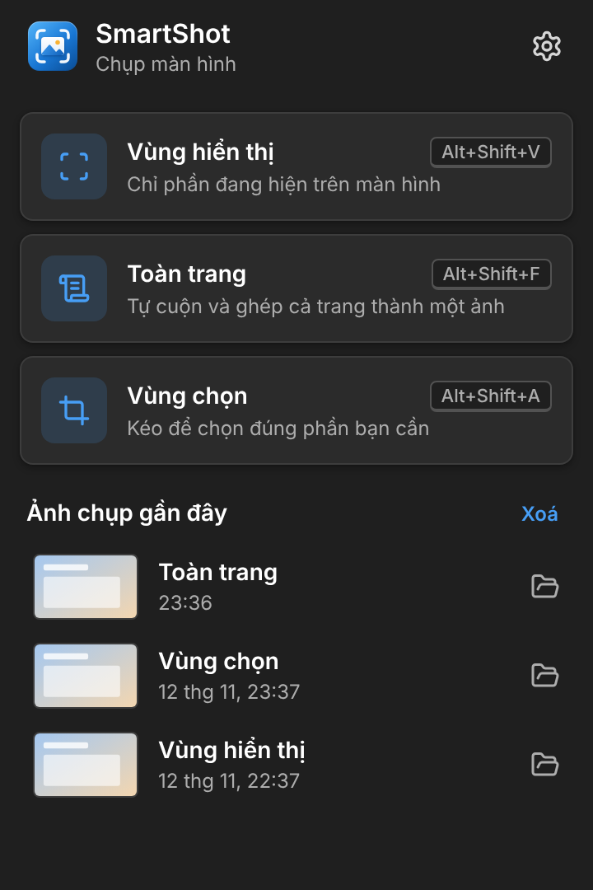
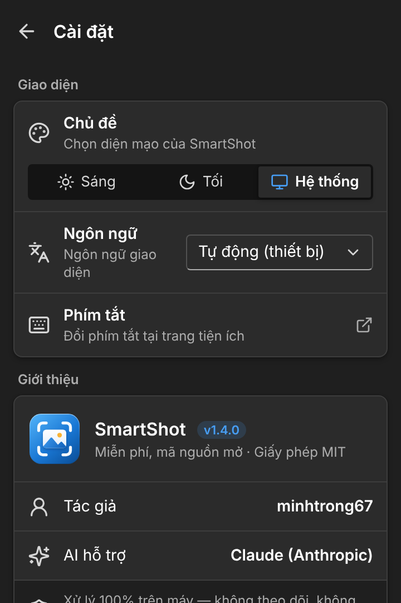

<div align="center">



# SmartShot — Screenshot

**Capture the visible area, a full page or any selection and save it as a PNG — in a clean Microsoft Fluent interface.**
Free, open source and 100% on-device.


[English](README.md) · [Tiếng Việt](README.vi.md)

</div>

---

## Screenshots

| Capture · Light | Settings · Light | Capture · Dark · Tiếng Việt | Settings · Dark · Tiếng Việt |
|---|---|---|---|
|  |  |  |  |

## Features

**Capture**
- **Visible area** — exactly what's on screen.
- **Full page** — scrolls and stitches one seamless tall image; sticky/fixed elements appear only once; works with `scroll-behavior: smooth` pages; very tall pages are capped at the browser's canvas limit.
- **Selected area** — drag a rectangle with a live size label.
- Every capture is saved as a PNG straight to your default Downloads folder.
- **Keyboard shortcuts** — `Alt+Shift+V` visible, `Alt+Shift+F` full page, `Alt+Shift+S` selected area (change them on `chrome://extensions/shortcuts`; the popup always shows the current keys).

**Recent captures**
- The last 10 captures with thumbnails; click one to **show the file in its folder**.
- **Clear** the list with an **Undo** toast in case it was a misclick.

**Settings** (inside the popup — no extra tab)
- **Theme** — Light / Dark / System.
- **Language** — Auto (device) / English / Tiếng Việt.
- **Keyboard shortcuts** — one click to the shortcuts page.
- **About** — version, author **minhtrong67** and AI assistant **Claude** (Anthropic).

**Design** — Microsoft Fluent 2: system font, Lucide icons, 4/8 px corner radii, subtle elevation, visible keyboard focus and reduced-motion support.

**Privacy** — no analytics, no network requests, minimal permissions (`activeTab`, `scripting`, `storage`, `offscreen`, `downloads`).

## Installation

**From the release package**
1. Download `download/SmartShot-Setup.zip` and extract it to a permanent folder.
2. Open `chrome://extensions` and enable **Developer mode**.
3. Click **Load unpacked** and select the extracted folder.
4. Pin the blue SmartShot icon to the toolbar.

**From source**
```bash
git clone https://github.com/minhtrong67/web-screenshot-ext.git
```
Load the cloned folder with **Load unpacked**. No build step is needed to run the extension.

> Requires Chrome / Edge / Brave **109+** (Offscreen Documents API).

## Tech stack

- **Manifest V3**: service worker + Offscreen Document (canvas work) + content script injected on demand
- Plain **HTML / CSS / JavaScript** — no framework, no runtime dependencies
- **Fluent 2** design tokens written by hand in `css/fluent.css`, with the platform's default system font
- **[Lucide](https://lucide.dev)** icons, bundled inline

## Project structure

```
manifest.json   popup.html   offscreen.html
css/            fluent.css (tokens + components) · popup.css (layout)
js/             background · content · offscreen · main (popup) · i18n · storage · theme · boot · lucide
icons/          extension icons (Fluent style)     screenshots/   README images
scripts/        build-lucide · build-icons · pack
```

## Development

```bash
npm install
npm run build:assets   # Lucide sprite (js/lucide.js) + extension icons
npm run pack           # dist/SmartShot-v<version>.zip + download/SmartShot-Setup.zip
```

## Known limitations

- Pages that scroll inside an inner container (not the whole page) are captured as a single visible frame.
- Browser pages (`chrome://…`) and the Web Store can't be captured.
- Chrome allows about two captures per second, so full-page capture of long pages takes a moment.

## Author

Created by **minhtrong67** with AI support from **Claude** (Anthropic). Released under the [MIT License](LICENSE).
