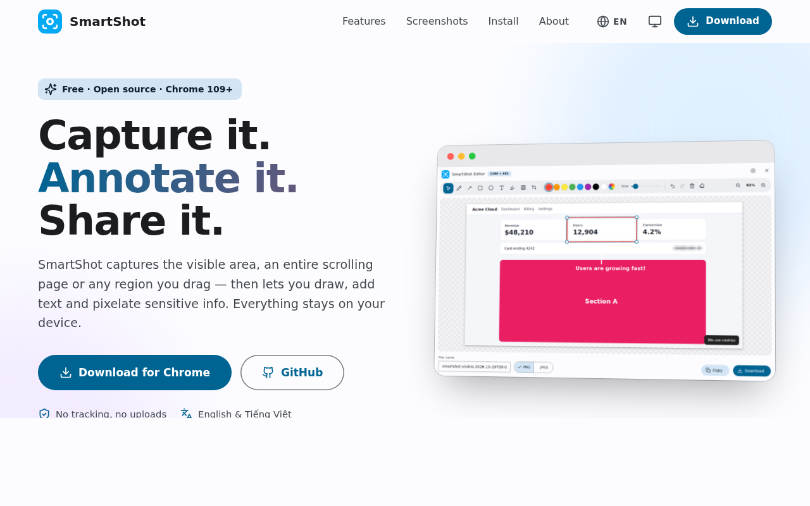

<div align="center">


# SmartShot — Screenshot & Annotate

**Capture the visible area, a full page or any selection — then annotate and redact it in a Material Design 3 editor.**
Free, open source and 100% on-device.


[English](README.md) · [Tiếng Việt](README.vi.md) · [Landing page](index.html)

</div>

---

## Screenshots

| Annotation editor | Capture popup | Settings |
|---|---|---|
|  |  |  |

| Dark · Tiếng Việt | Dark editor · Teal accent | Landing page |
|---|---|---|
|  |  |  |

## Features

**Capture**
- **Visible area** — exactly what's on screen.
- **Full page** — scrolls and stitches one seamless tall image; sticky/fixed elements appear only once; works with `scroll-behavior: smooth` pages; very tall pages are capped at the browser's canvas limit.
- **Selected area** — drag a rectangle with a live size label.
- Every capture opens in the editor, where you can download or copy it — or turn the editor off in Settings (**After capturing**) to save the PNG straight to your default Downloads folder.

**Editor**
- Pen, arrow, rectangle, ellipse, multi-line text, highlighter, **pixelate / redact** and crop.
- Non-destructive: select, move, resize, recolor and delete any annotation; nudge with arrow keys.
- Undo / redo (60 steps), zoom (`Ctrl` + wheel), fit-to-window, paste or drop any image to edit.
- Export PNG or JPEG (quality slider), editable file name, download or copy to clipboard.
- Shortcuts: `V P A R E T H B C` for tools, `Ctrl+Z / Y`, `Ctrl+S`, `Ctrl+C`, `Del`, `Shift` to constrain.

**Settings** (inside the popup — no extra tab needed)
- **Theme color** — the 19 Material colors, generated as full Material 3 color roles.
- **Theme** — Light / Dark / System (auto-detected).
- **Language** — English / Tiếng Việt / Auto (follows the device).
- About card with the author and a button that opens the bundled landing page in a new tab.

**Privacy** — no analytics, no network requests, minimal permissions (`activeTab`, `scripting`, `storage`, `offscreen`, `downloads`).

## Installation

**From the release package**
1. Download `download/SmartShot-Setup.zip` and extract it to a permanent folder.
2. Open `chrome://extensions` and enable **Developer mode**.
3. Click **Load unpacked** and select the extracted folder.
4. Pin the blue SmartShot icon to the toolbar.

**From source**
```bash
git clone https://github.com/minhtrong67/web-screenshot-ext.git
```
Load the cloned folder with **Load unpacked**. No build step is needed to run the extension.

> Requires Chrome / Edge / Brave **109+** (Offscreen Documents API).

## Tech stack

- **Manifest V3**: service worker + Offscreen Document (canvas work) + content script injected on demand
- Plain **HTML / CSS / JavaScript** — no framework, no runtime dependencies
- **Material Design 3** tokens generated with [`@material/material-color-utilities`](https://github.com/material-foundation/material-color-utilities)
- **[Lucide](https://lucide.dev)** icons, bundled inline; the platform's default system font
- The landing page (`index.html`) is a single file, opened inside the extension as a sandboxed page

## Project structure

```
manifest.json   popup.html   editor.html   offscreen.html   index.html (landing)
css/            Material tokens (generated), components, popup, editor
js/             background · content · offscreen · popup · editor · i18n · storage · theme
icons/          extension icons (#03A9F4)     screenshots/   image01 … image06
scripts/        build-themes · build-lucide · build-icons · pack
```

## Development

```bash
npm install
npm run build:assets   # themes.css + accents.js, lucide.js, icons
npm run pack           # dist/SmartShot-v<version>.zip + download/SmartShot-Setup.zip
```

## Known limitations

- Pages that scroll inside an inner container (not the whole page) are captured as a single visible frame.
- Browser pages (`chrome://…`) and the Web Store can't be captured.
- Chrome allows about two captures per second, so full-page capture of long pages takes a moment.

## Author

Created by **minhtrong67** with AI support from **Claude** (Anthropic). Released under the [MIT License](LICENSE).
