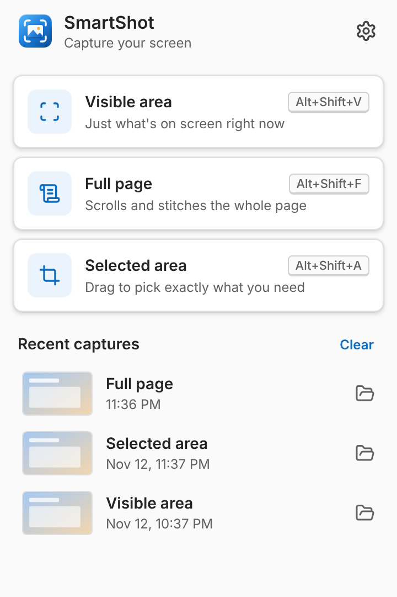
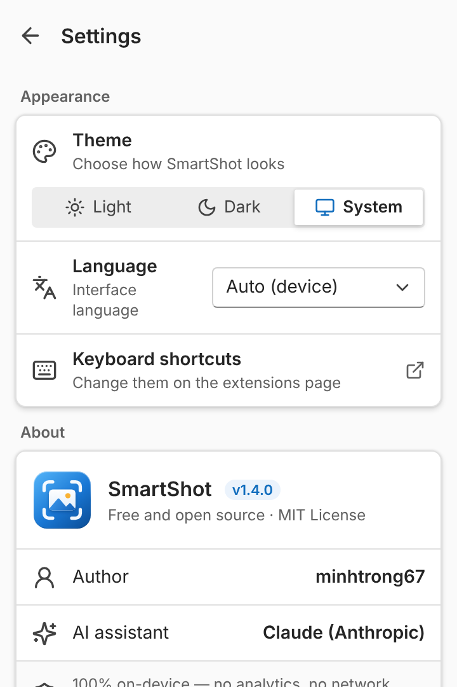
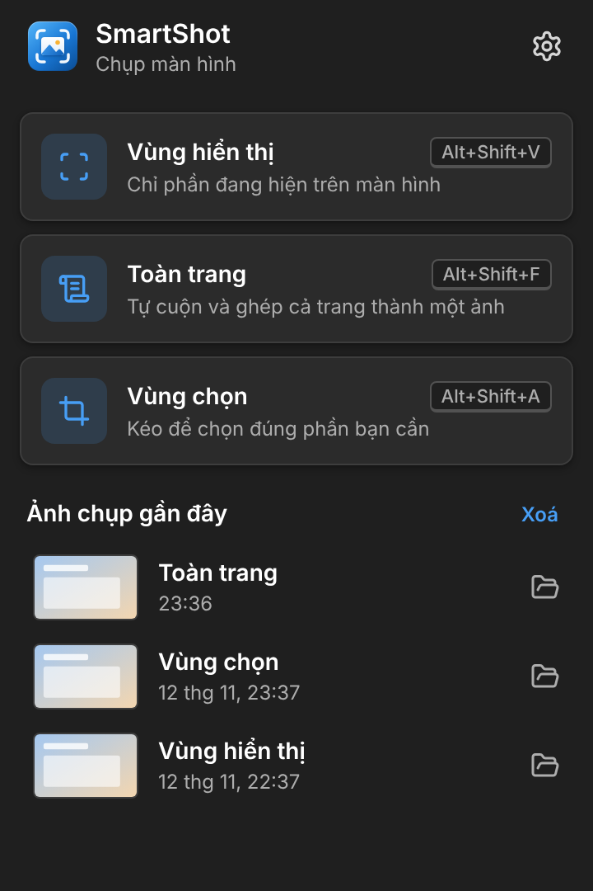
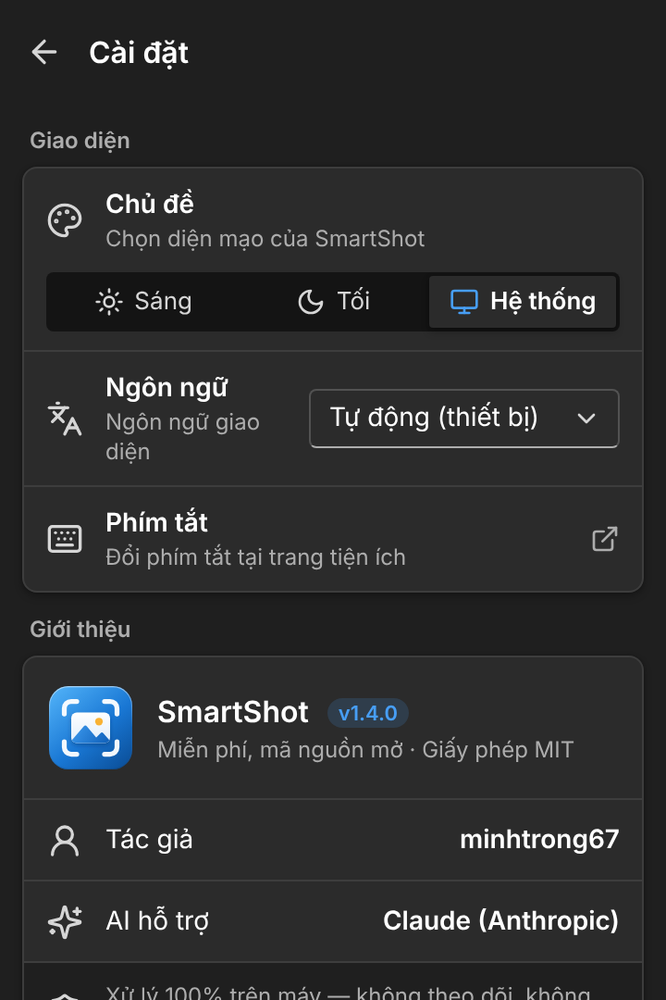

<div align="center">


# SmartShot — Chụp Màn Hình

**Chụp vùng hiển thị, toàn trang hoặc vùng chọn và lưu thành ảnh PNG — với giao diện Microsoft Fluent gọn gàng.**
Miễn phí, mã nguồn mở, xử lý 100% trên máy.


[English](README.md) · [Tiếng Việt](README.vi.md)

</div>

---

## Ảnh minh hoạ

| Chụp · Sáng | Cài đặt · Sáng | Chụp · Tối · Tiếng Việt | Cài đặt · Tối · Tiếng Việt |
|---|---|---|---|
|  |  |  |  |

## Tính năng

- **Chụp**: vùng hiển thị, toàn trang (tự cuộn và ghép liền mạch), vùng chọn có hiển thị kích thước. Ảnh PNG được lưu thẳng vào thư mục Downloads mặc định.
- **Phím tắt**: `Alt+Shift+V` vùng hiển thị, `Alt+Shift+F` toàn trang, `Alt+Shift+S` vùng chọn (đổi tại `chrome://extensions/shortcuts`; popup luôn hiển thị phím hiện tại).
- **Ảnh chụp gần đây**: 10 ảnh mới nhất kèm ảnh thu nhỏ; bấm vào để **hiện tệp trong thư mục**. Nút **Xoá** có thông báo **Hoàn tác**.
- **Cài đặt** (ngay trong popup): chủ đề Sáng/Tối/Hệ thống, ngôn ngữ Tự động/English/Tiếng Việt, lối tắt tới trang phím tắt, mục Giới thiệu gồm phiên bản, tác giả **minhtrong67** và AI hỗ trợ **Claude** (Anthropic).
- **Thiết kế**: Microsoft Fluent 2, dùng font hệ thống, icon Lucide.
- **Riêng tư**: không theo dõi, không gọi mạng, quyền tối thiểu.

## Cài đặt

1. Tải `download/SmartShot-Setup.zip` và giải nén vào một thư mục cố định.
2. Mở `chrome://extensions`, bật **Chế độ nhà phát triển**.
3. Chọn **Tải tiện ích đã giải nén** và trỏ tới thư mục vừa giải nén.
4. Ghim biểu tượng SmartShot màu xanh lên thanh công cụ.

> Yêu cầu Chrome / Edge / Brave **109+**.

## Phát triển

```bash
npm install
npm run build:assets   # icon Lucide, icon extension
npm run pack           # đóng gói zip
```

## Hạn chế đã biết

- Trang cuộn bên trong một khung con (không phải cuộn cả trang) chỉ chụp được một khung hình.
- Không chụp được trang `chrome://…` và Web Store.

## Tác giả

**minhtrong67**, với sự hỗ trợ của AI **Claude** (Anthropic). Giấy phép [MIT](LICENSE).
