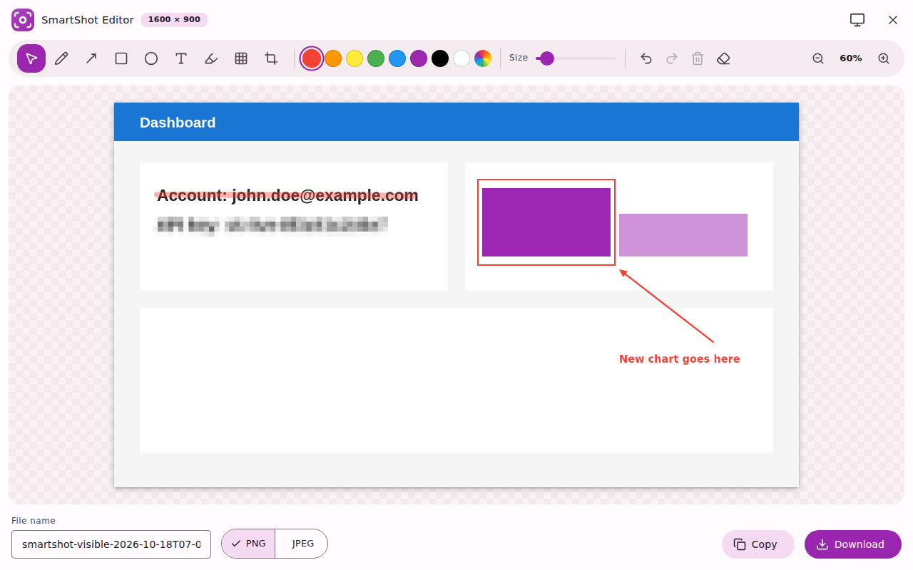
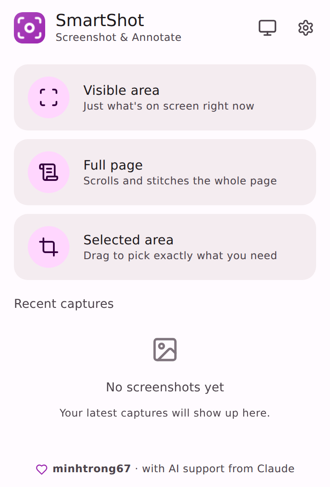
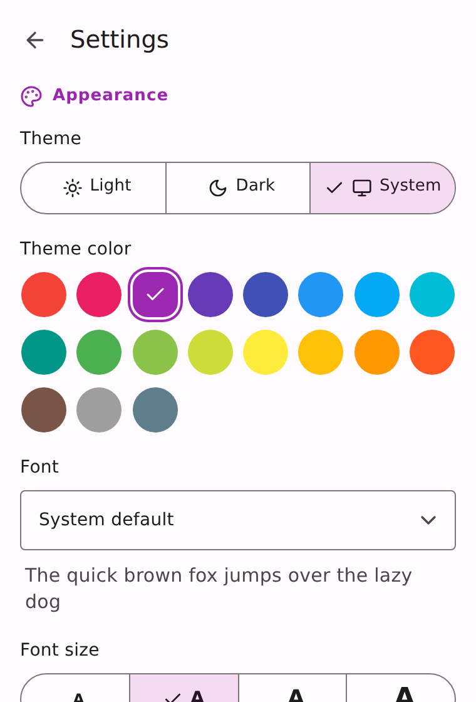
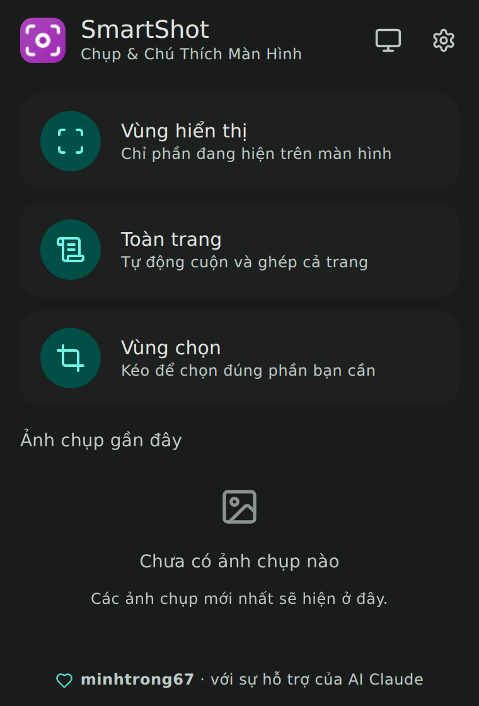
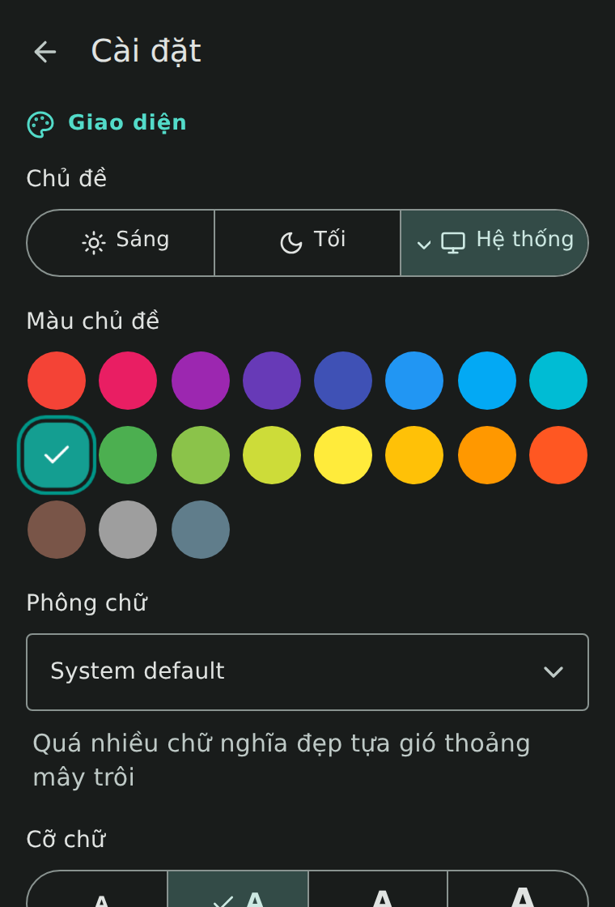

<div align="center">


# SmartShot — Chụp & Chú Thích Màn Hình

**Chụp vùng hiển thị, toàn trang hoặc vùng chọn — rồi chú thích và che thông tin nhạy cảm trong trình chỉnh sửa Material Design 3.**
Miễn phí, mã nguồn mở, xử lý 100% trên máy.

[English](README.md) · [Tiếng Việt](README.vi.md) · [Landing page](index.html)

</div>

---

## Giới thiệu
SmartShot là tiện ích Chrome / Chromium gọn nhẹ để chụp và chú thích ảnh màn hình, với giao diện Material Design 3 tự nhận ngôn ngữ và chủ đề của thiết bị. Không có gì được tải lên đâu cả.

## Ảnh minh hoạ
| Trình chú thích | Cửa sổ chụp | Cài đặt |
|---|---|---|
|  |  |  |

| Tối · Tiếng Việt | Màu xanh mòng két |
|---|---|
|  |  |

## Tính năng
- **Chụp**: vùng hiển thị, toàn trang (tự cuộn & ghép, header dính chỉ xuất hiện một lần), vùng chọn; lưu vào Downloads, clipboard hoặc mở trình chỉnh sửa.
- **Trình chỉnh sửa**: bút, mũi tên, hình chữ nhật, elip, chữ, bút dạ quang, **che điểm ảnh**, cắt ảnh; chọn / di chuyển / đổi cỡ / đổi màu / xoá chú thích; hoàn tác 60 bước; thu phóng; xuất PNG/JPEG; sao chép clipboard.
- **Tuỳ biến**: sáng / tối / hệ thống, **19 màu Material**, nhiều phông chữ phổ biến (mặc định phông hệ thống), 4 cỡ chữ.
- **Hai ngôn ngữ** Tiếng Việt & English — tự nhận theo thiết bị.
- **Riêng tư**: không theo dõi, không gọi mạng, quyền tối thiểu.

## Cài đặt
1. Tải `download/SmartShot-Setup.zip` và giải nén vào một thư mục cố định.
2. Mở `chrome://extensions`, bật **Chế độ nhà phát triển**.
3. Nhấn **Tải tiện ích đã giải nén** và chọn thư mục vừa giải nén.
4. Ghim biểu tượng SmartShot màu tím lên thanh công cụ.

Yêu cầu Chrome / Edge / Brave **109+**.

## Công nghệ
Manifest V3, HTML/CSS/JS thuần, Material Design 3 (`@material/material-color-utilities`), icon [Lucide](https://lucide.dev), font tự host (Fontsource), IndexedDB + `chrome.storage`.

## Phát triển
```bash
npm install
npm run build:assets   # sinh themes.css, lucide.js, icon PNG
```
Sửa mã rồi bấm **Tải lại** ở `chrome://extensions`.

## Build
```bash
npm run pack   # → dist/SmartShot-v<version>.zip và download/SmartShot-Setup.zip
```

## Cấu trúc dự án
Xem sơ đồ chi tiết trong [README.md](README.md#project-structure).

## Giấy phép
Dự án công khai, mã nguồn mở theo **[Giấy phép MIT](LICENSE)**.

## Tác giả
**[minhtrong67](https://github.com/minhtrong67)** — với sự hỗ trợ của AI **Claude** (Anthropic).
