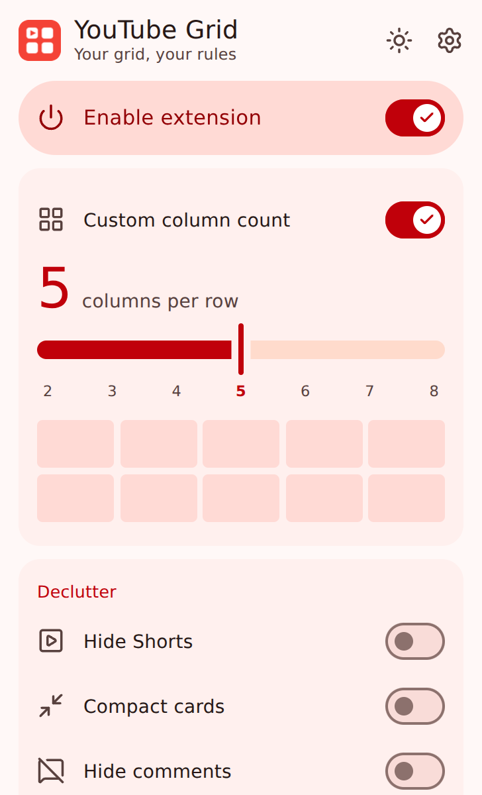
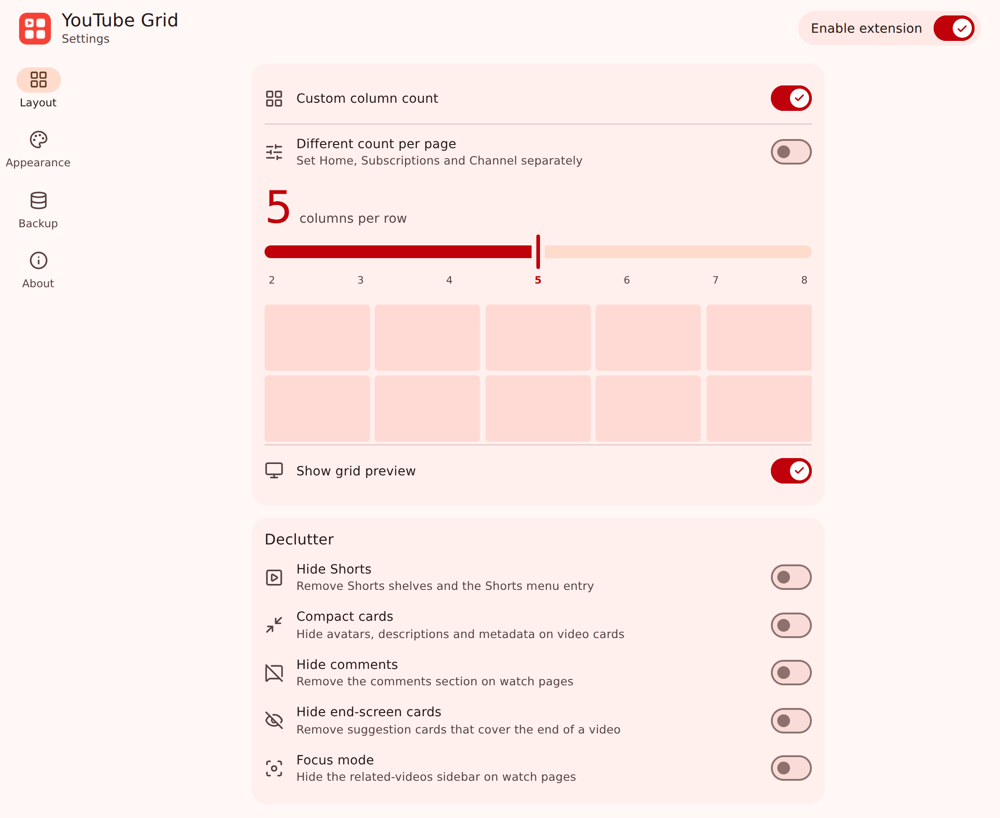
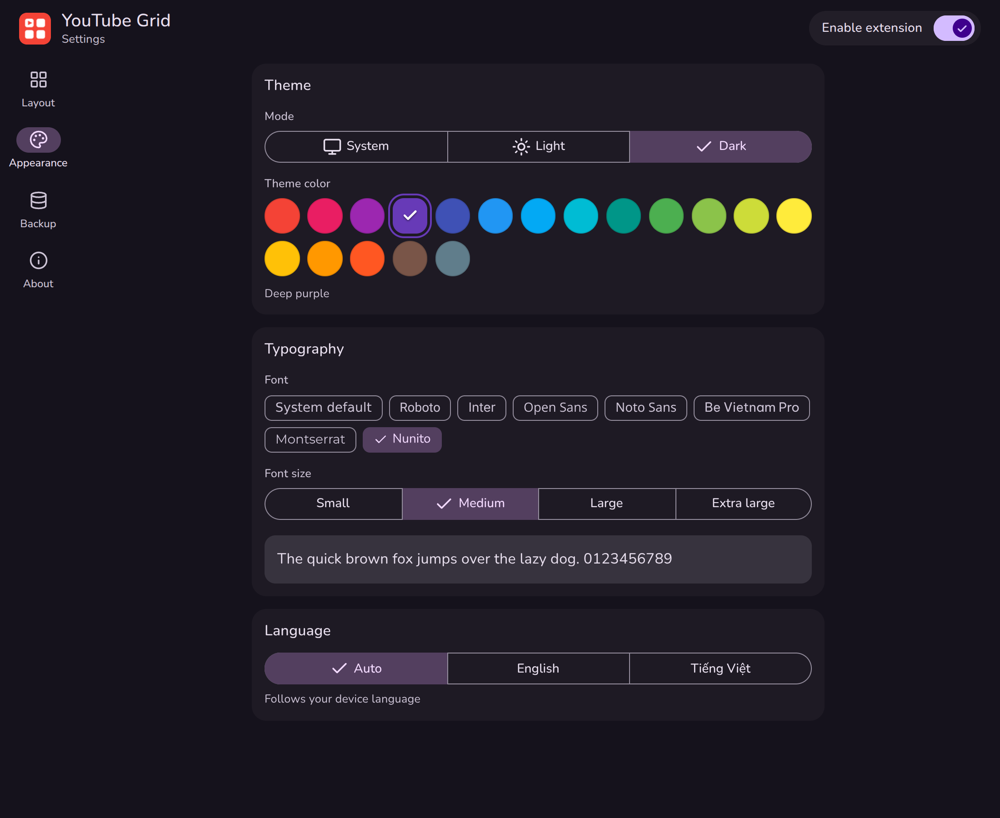
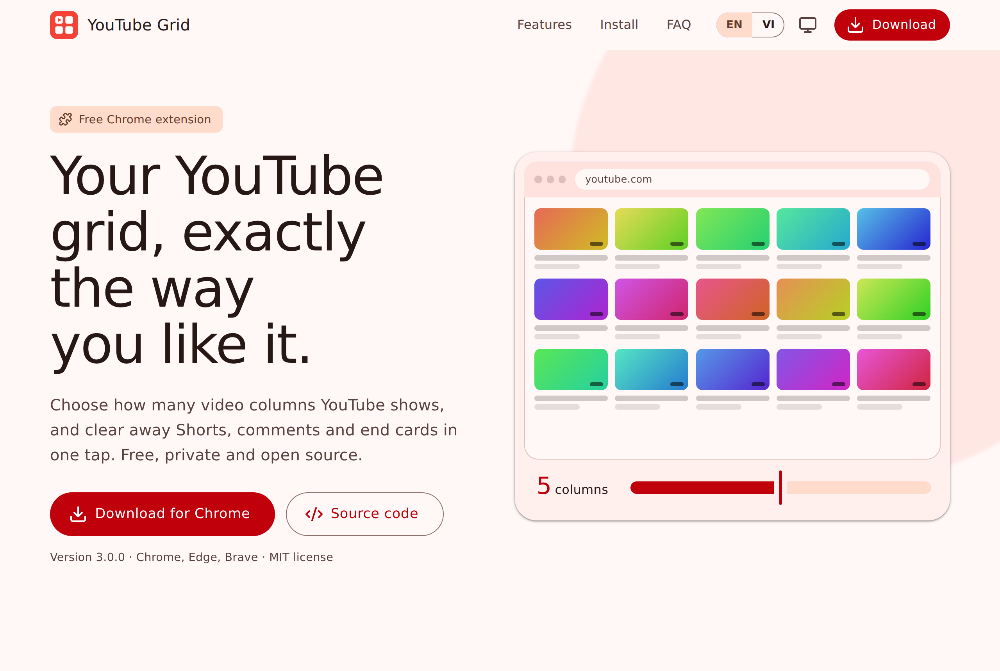

<div align="center">


# YouTube Grid

**Your grid, your rules.** Choose how many video columns YouTube shows, and declutter Shorts, comments and end cards in one tap.

[](https://developer.chrome.com/docs/extensions/mv3/intro/)
[](https://m3.material.io/)
[](LICENSE)
[](#features)

[Download](download/youtube-grid.zip) · [Landing page](index.html) · [Report an issue](https://github.com/minhtrong67/youtube-grid/issues)

</div>

---

## Introduction

YouTube decides how many videos fit on a row. **YouTube Grid** gives that decision back to you: pick anywhere from 2 to 8 columns for the Home, Subscriptions and Channel pages, hide the parts of YouTube you never use, and style the extension itself with any Material Design color, font and size.

It is small, fast and private: pure CSS injected into the page, no tracking, no network requests, no accounts. Free and open source.

## Screenshots

| Popup | Settings → Layout |
|:---:|:---:|
|  |  |

| Settings → Appearance | Landing page |
|:---:|:---:|
|  |  |

## Features

- **Custom column count** — 2 to 8 columns, applied instantly on every open YouTube tab. On narrow windows the grid gracefully uses fewer columns instead of crushing thumbnails.
- **Different count per page** — set Home, Subscriptions and Channel independently.
- **One-tap decluttering** — hide Shorts, comments, end-screen cards and the related-videos sidebar (focus mode), or switch to compact video cards.
- **Material Design 3 interface** — real M3 color roles generated with Google's `material-color-utilities`, ripple, switches, sliders, dialogs and motion that respects `prefers-reduced-motion`.
- **18 theme colors** — every Material Design swatch: Red, Pink, Purple, Deep Purple, Indigo, Blue, Light Blue, Cyan, Teal, Green, Light Green, Lime, Yellow, Amber, Orange, Deep Orange, Brown, Blue Grey.
- **Light, dark or system** mode, following your OS live.
- **Fonts** — system font by default, or Roboto, Inter, Open Sans, Noto Sans, Be Vietnam Pro, Montserrat, Nunito (bundled, loaded only when selected) — plus four font sizes.
- **English and Vietnamese** — the device language is detected automatically on first launch; you can switch any time.
- **Keyboard shortcut** — `Alt+Shift+Y` toggles custom columns (change it at `chrome://extensions/shortcuts`).
- **Toolbar badge** — shows the active column count.
- **Landing page inside the extension** — the popup's *Landing page* button opens the bundled `index.html` in a new tab, no internet needed.
- **Backup & restore** — export and import your settings as JSON (validated on import).
- **Private by design** — settings live in `chrome.storage.local`; nothing leaves your device.

## Installation

YouTube Grid works on Chrome, Edge, Brave and other Chromium browsers **version 111 or newer**.

1. Download `youtube-grid.zip` from the [`download/`](download/) folder (or the landing page) and **unzip** it into a folder you will keep.
2. Open `chrome://extensions`.
3. Turn on **Developer mode** (top right).
4. Click **Load unpacked** and choose the unzipped folder.
5. Open YouTube, click the toolbar icon and switch on **Custom column count**.

> Installing from the source repository works the same way: choose the repository root with **Load unpacked**.

## Tech stack

| Area | Choice |
|---|---|
| Platform | Chrome Extension, **Manifest V3** (service worker, content script, popup, options page) |
| Language | Vanilla JavaScript (ES2020), HTML, CSS — no framework, no bundler, no runtime dependencies |
| Design | **Material Design 3** tokens and components, hand-built |
| Color | `@material/material-color-utilities` (Vibrant scheme) → `css/palettes.css` |
| Icons | [Lucide](https://lucide.dev) (ISC), inlined as SVG → `js/icons.js` |
| Fonts | [Fontsource](https://fontsource.org) self-hosted WOFF2 (Latin + Vietnamese subsets) |
| Storage | `chrome.storage.local` with a validated, versioned schema |
| i18n | Built-in EN/VI dictionary with automatic device-language detection |

## Development

```bash
git clone https://github.com/minhtrong67/youtube-grid.git
cd youtube-grid
```

There is nothing to compile. Load the folder with **Load unpacked** (see [Installation](#installation)) and click the reload icon on `chrome://extensions` after each change.

Optional — regenerate the generated assets (needs Node.js 18+):

```bash
npm install          # material-color-utilities + lucide-static
npm run generate     # rewrites css/palettes.css and js/icons.js
python scripts/make-icons.py   # re-renders icons/*.png (needs: pip install pillow)
```

Where things live:

- `js/storage.js` — settings schema, validation, serialized writes. **Always change settings through `store.patch()`** so the popup, options page and shortcut never overwrite each other.
- `js/content.js` — builds one `<style>` tag from the settings. YouTube selectors live here; if YouTube changes its markup, this is the only file to adjust.
- `js/i18n.js` — add a language by adding a dictionary and a `LANGUAGES` entry.

## Build

```bash
npm run build
```

Produces `dist/youtube-grid-v<version>.zip` containing only the files the browser needs (the landing page `index.html` is included; README, scripts and screenshots are not). To publish it on the landing page, copy it to `download/youtube-grid.zip`.

## Project structure

```
youtube-grid/
├── manifest.json            Extension manifest (MV3)
├── popup.html               Toolbar popup
├── options.html             Full settings page
├── index.html               Landing page (single self-contained file)
├── css/
│   ├── tokens.css           M3 shape, motion, elevation, font + size tokens
│   ├── palettes.css         Generated: 18 colors × light/dark
│   ├── components.css       Shared M3 components
│   ├── popup.css            Popup layout
│   ├── options.css          Settings layout (rail / bottom bar)
│   └── fonts.css            Bundled @font-face rules
├── js/
│   ├── storage.js           Settings schema + store
│   ├── i18n.js              English / Vietnamese + auto-detect
│   ├── theme.js, boot.js    Appearance (no flash on open)
│   ├── ui.js                Ripple, snackbar, dialog helpers
│   ├── icons.js             Generated Lucide icon registry
│   ├── content.js           Injects grid/declutter CSS into YouTube
│   ├── background.js        Badge, shortcut, first-run
│   ├── popup.js             Popup logic
│   └── options.js           Settings page logic
├── _locales/{en,vi}/        Store name and description
├── fonts/                   Bundled WOFF2 fonts
├── icons/                   Extension icons (#F44336) + icon.svg source
├── assets/og-cover.png      Social sharing image (1200×630)
├── screenshots/             image01.png, image02.png, …
├── download/                Put youtube-grid.zip here
├── scripts/                 generate-palettes, generate-icons, make-icons, build
├── LICENSE
└── README.md
```

## License

Released under the [MIT License](LICENSE) — free to use, modify and distribute. Contributions are welcome.

Made by **minhtrong67**, with the help of **Claude** (AI by Anthropic).

*YouTube is a trademark of Google LLC. This project is independent and not affiliated with or endorsed by YouTube or Google.*
