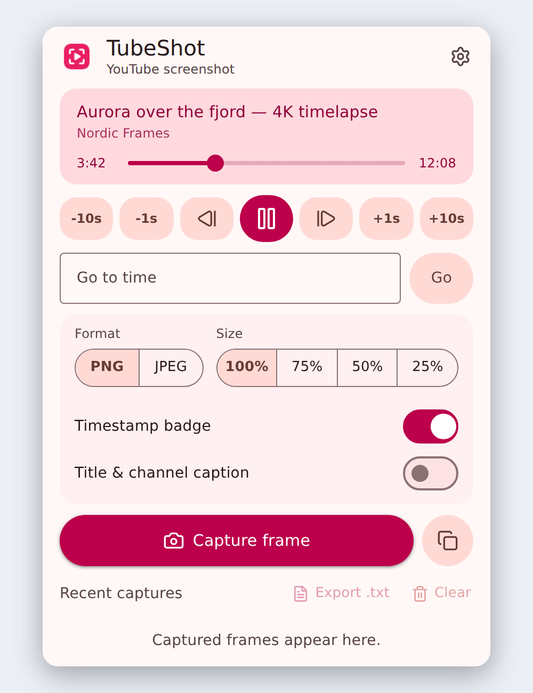
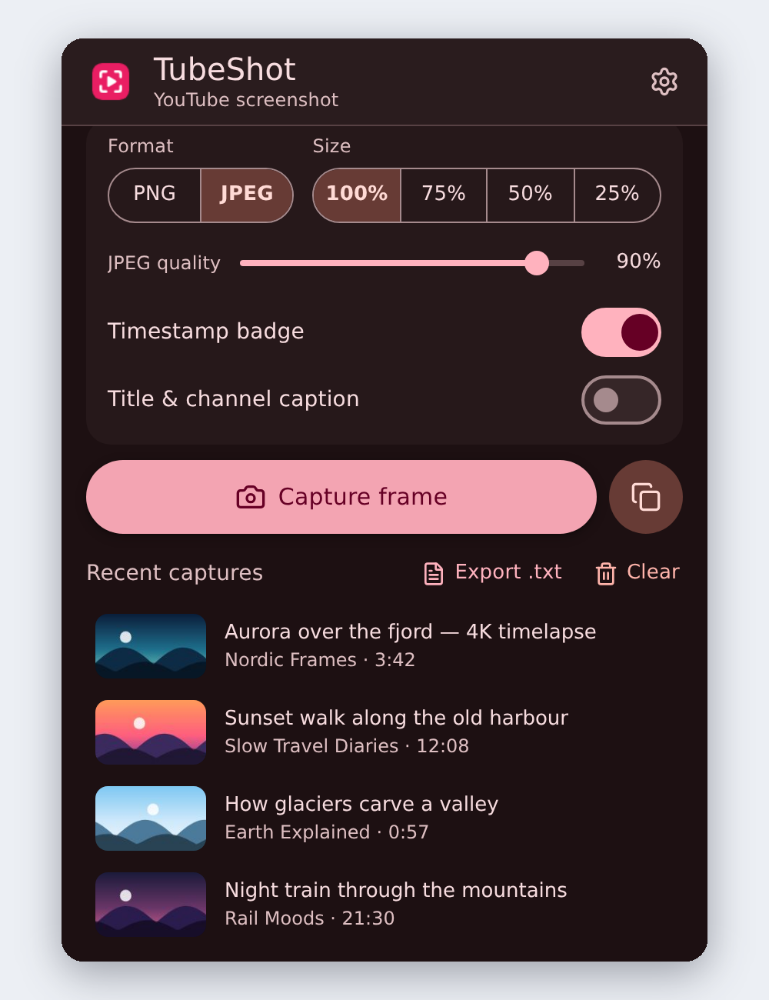
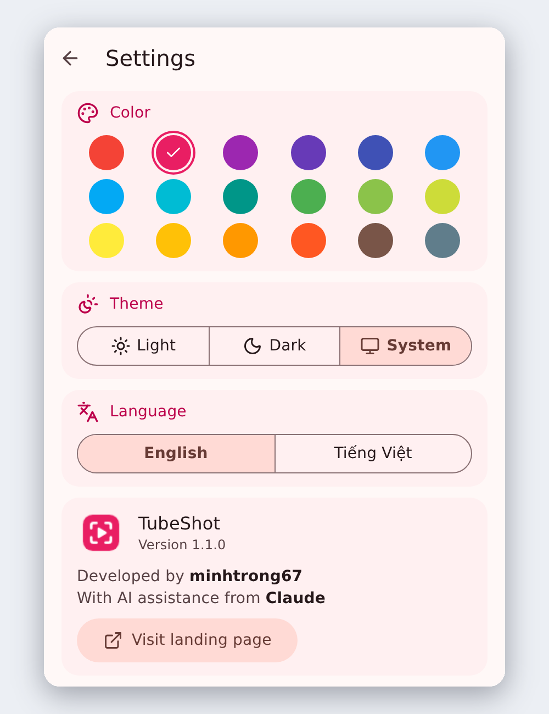
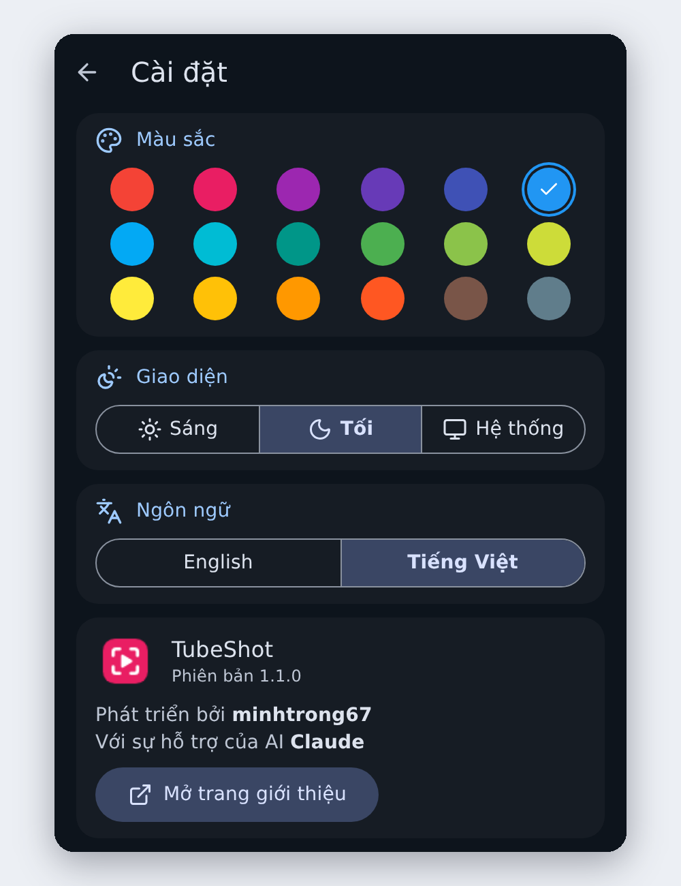
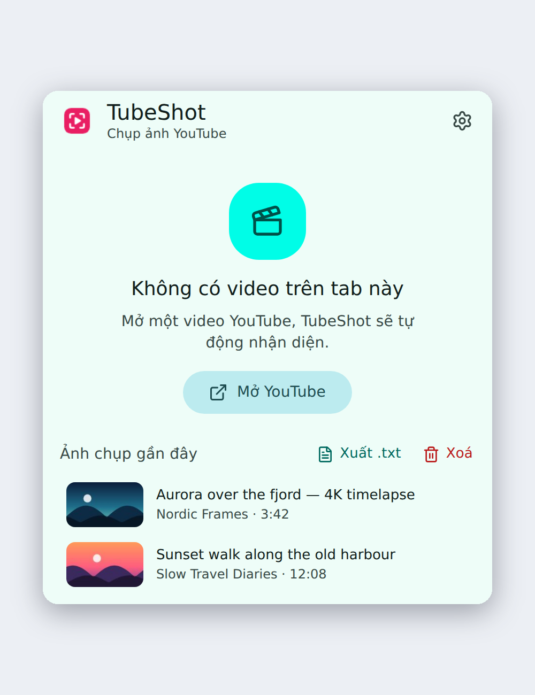
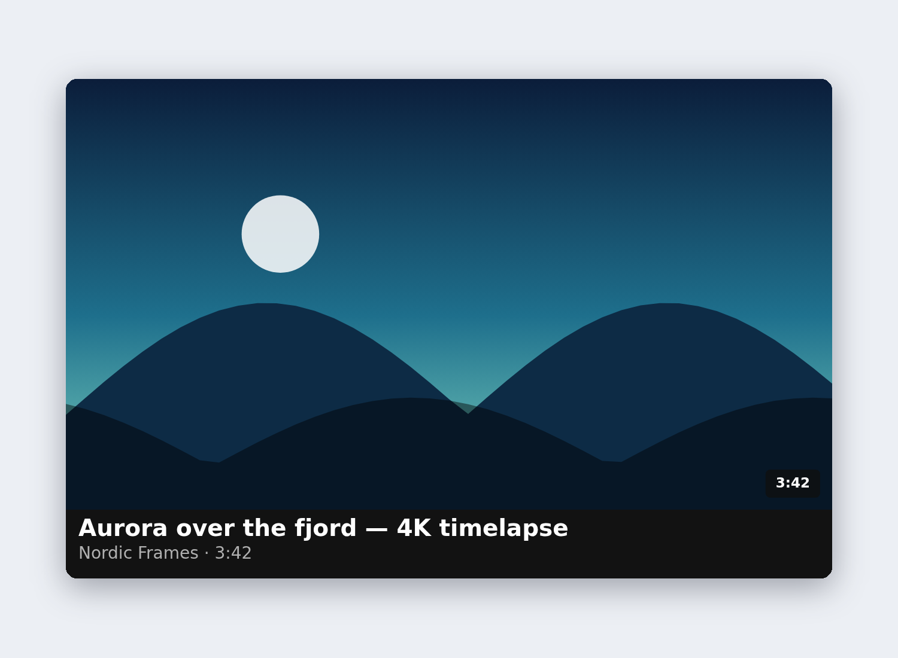
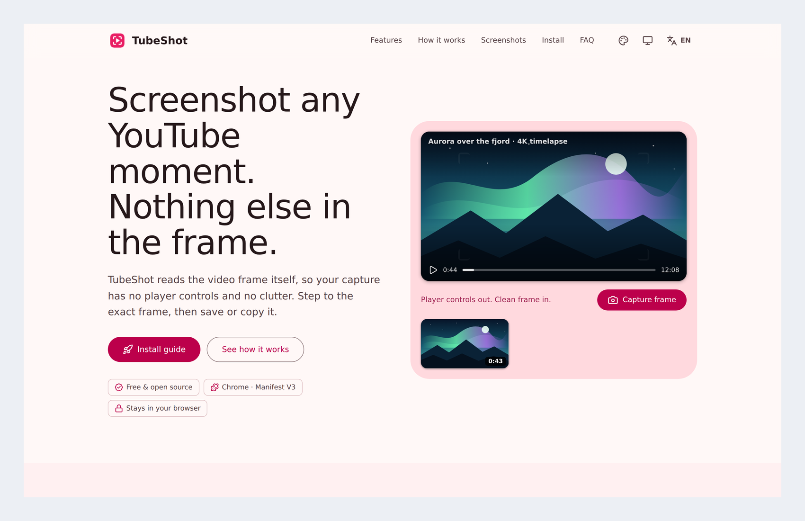
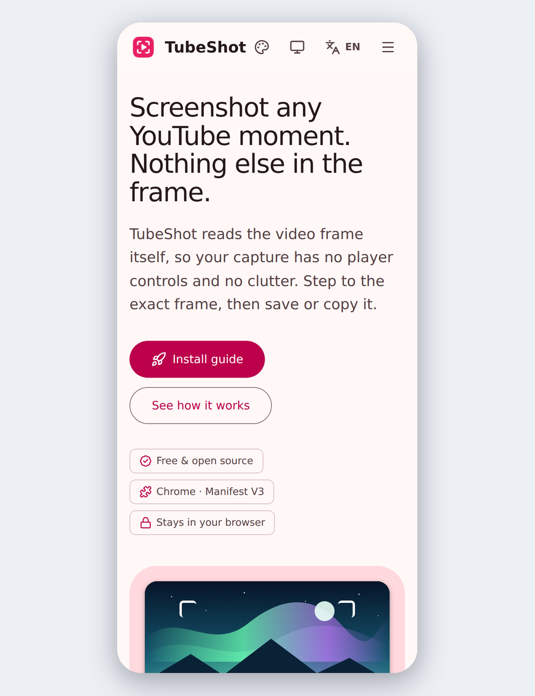

<div align="center">


# TubeShot

**Clean YouTube screenshots, frame by frame.**

A free, open-source Chrome extension that captures control-free frames from any YouTube video, with frame-accurate seeking, optional timestamp and caption, and a Material Design 3 interface.


**English** · [Tiếng Việt](README.vi.md)

</div>

---

## Introduction

Regular screenshot tools capture whatever is on your screen: the player controls, YouTube's interface and your browser chrome. TubeShot reads the video frame directly from the page by drawing the `<video>` element onto a canvas, so every capture is the picture and nothing else, at the video's native resolution.

Open `index.html` for the project landing page (it also opens from **Settings → Visit landing page**).

## Screenshots

| | | |
|:---:|:---:|:---:|
| <br/>Playback controls and capture options | <br/>Dark theme, JPEG quality and history | <br/>Settings: color, theme, language |
| <br/>Tiếng Việt, dark theme, blue | <br/>Empty state | <br/>A real capture with badge and caption |

### Landing page

<p align="center">
  
  
</p>

## Features

- **Clean frames.** No player controls, overlays or browser chrome. Captured at the video's native resolution.
- **Frame-accurate seeking.** Jump ±10 s or ±1 s, step one frame, drag the scrubber or type a time such as `1:23` or `1:02:03`.
- **Timestamp badge and caption.** Stamp the time in a corner, or add a strip with the title, channel and time.
- **PNG or JPEG.** Lossless PNG, or JPEG with adjustable quality, at 100, 75, 50 or 25 percent.
- **Save or copy.** Download to your Downloads folder or copy to the clipboard.
- **Recent captures.** The last ten captures with thumbnails. Click one to reopen the video at that second, or export the list as `.txt`.
- **Videos, Shorts and live streams** on `youtube.com` and `m.youtube.com`.
- **Material Design 3.** 18 Material colors, light, dark or system theme, system font, [Lucide](https://lucide.dev) icons.
- **English and Tiếng Việt.** Detected from the browser language on first run.
- **Private.** No server, no analytics, no account. Everything stays in your browser.

## Installation

TubeShot loads as an unpacked extension in Chrome, Edge, Brave and other Chromium browsers.

1. Download the project and unzip it.
2. Open `chrome://extensions`.
3. Turn on **Developer mode** (top-right).
4. Click **Load unpacked** and select the folder that contains `manifest.json`.
5. Pin TubeShot to the toolbar, open a YouTube video and click the icon.

### Permissions

| Permission | Why it is needed |
|---|---|
| `storage` | Saves your settings and capture history on your device. |
| `downloads` | Saves captured frames to your Downloads folder. |
| `scripting` | Loads TubeShot into a YouTube tab that was already open before installation. |
| `youtube.com`, `m.youtube.com` | Lets the content script read the video frame. It cannot run on other sites. |

## Tech stack

- Plain **HTML, CSS and JavaScript**, Manifest V3. No framework, no build step, no runtime dependencies.
- **Canvas API** to read and compose video frames.
- **Material Design 3** color schemes generated with [`@material/material-color-utilities`](https://github.com/material-foundation/material-color-utilities) (development only).
- **Lucide** icons, bundled inline in `js/icons.js` (ISC license).
- `chrome.storage.local`, `chrome.downloads`, `chrome.scripting`, `chrome.tabs`.

## Development

There is nothing to compile. Edit the files, then press the reload button on `chrome://extensions`.

To regenerate the color palettes (`css/palettes.css` and the copy inlined in `index.html`):

```bash
npm install --no-save @material/material-color-utilities@0.3.0
node scripts/generate-palettes.cjs
```

How it works: the popup talks to `js/content.js` with `chrome.tabs.sendMessage`. The content script picks the visible `<video>`, reports its state, seeks it, and draws frames to a canvas. Theme and color are plain `data-theme` and `data-color` attributes on `<html>`.

The landing page `index.html` is declared as a sandboxed extension page, so it opens in a new tab from Settings with the inline scripts it needs. It also works as an ordinary static page on any host.

## Build

No build step is required. To publish a package, zip the project folder without `scripts/` and `screenshots/` (the landing page uses `screenshots/`, so keep that folder if you ship `index.html`):

```bash
zip -r tubeshot-1.1.0.zip . -x "scripts/*" "*.md" ".git/*"
```

## Project structure

```
tubeshot/
├── manifest.json          Extension manifest (Manifest V3)
├── popup.html             Popup UI: capture view and settings view
├── index.html             Landing page (single file, Material Design 3, EN/VI)
├── README.md / README.vi.md
├── LICENSE
├── css/
│   ├── popup.css          Material Design 3 components and layout
│   └── palettes.css       Generated color schemes (18 colors x light/dark)
├── js/
│   ├── main.js            Popup logic, polling, capture, settings
│   ├── content.js         Runs on YouTube: finds video, seeks, captures frames
│   ├── storage.js         Settings (validated) and history
│   ├── theme.js           Theme and color handling
│   ├── i18n.js            English and Vietnamese strings
│   └── icons.js           Bundled Lucide icons
├── icons/                 Extension icons (16, 32, 48, 128), SVG sources, social card
├── _locales/              Localized extension name and description (en, vi)
├── screenshots/           image01.png ... image08.png
└── scripts/               Palette generator
```

## Known limitations

- Videos protected by DRM (some rentals and movies) render black and cannot be captured by any extension.
- Embedded players on other websites are not supported.
- History stores a small thumbnail and metadata, not the full-resolution image.
- If YouTube changes its page markup, the title and channel may fall back to the page title. The captured frame itself is unaffected.

## Credits

Developed by **minhtrong67**, with AI assistance from **Claude**.

## License

Released under the [MIT License](LICENSE). Free and open source.
