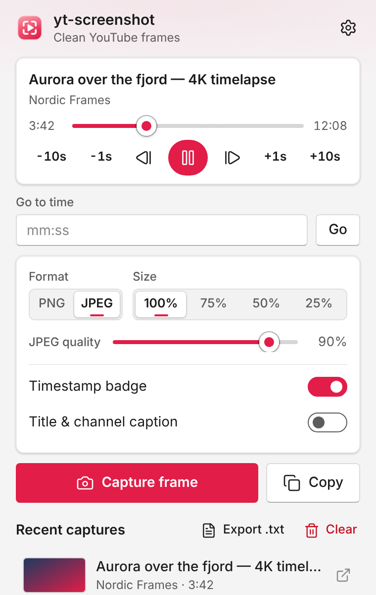
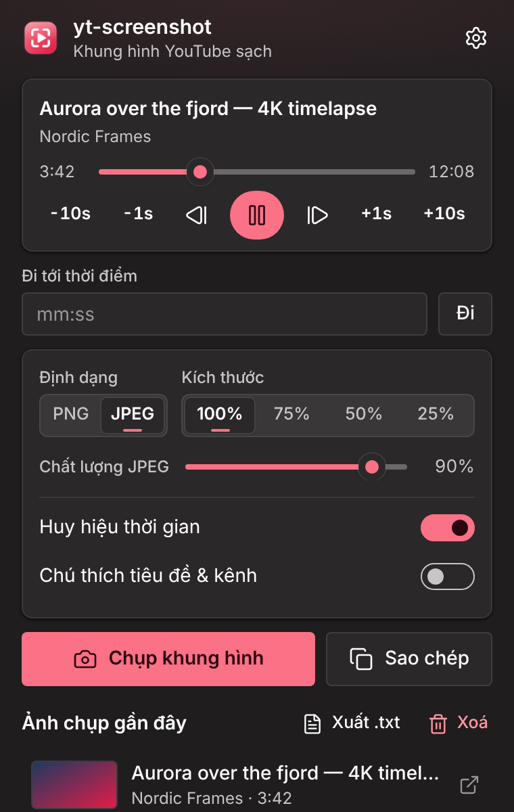
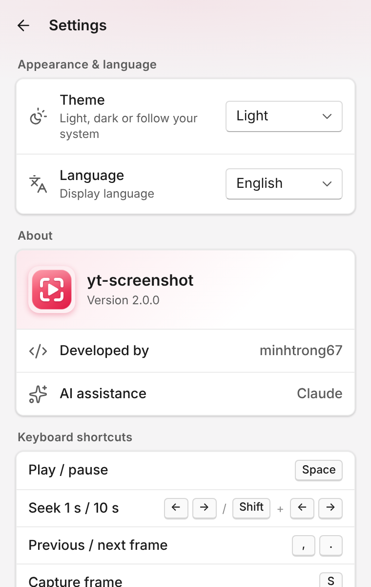

<div align="center">


# YT Screenshot

**Clean YouTube screenshots, frame by frame.**

A free, open-source Chrome extension that captures control-free frames from any YouTube video, with frame-accurate seeking, optional timestamp and caption, and a Fluent Design interface.

**English** · [Tiếng Việt](README.vi.md)

</div>

---

## Screenshots

| | | |
|:---:|:---:|:---:|
| <br/>Light theme | <br/>Dark theme, Tiếng Việt | <br/>Settings |

## Features

- **Clean frames.** No player controls, overlays or browser chrome, at the video's native resolution.
- **Frame-accurate seeking.** ±10 s, ±1 s, single-frame steps, a scrubber, or type a time such as `1:23`.
- **Timestamp badge and caption.** Stamp the time in a corner or add a title / channel strip.
- **PNG or JPEG** at 100, 75, 50 or 25 percent, with adjustable JPEG quality.
- **Save or copy** to the clipboard.
- **Keyboard shortcuts** in the popup: `Space` play/pause, `←` `→` seek (hold `Shift` for 10 s), `,` `.` step a frame, `S` capture, `C` copy.
- **Recent captures** with thumbnails; click to reopen the video at that second, or export as `.txt`.
- **Fluent Design.** Rose accent, system font, [Lucide](https://lucide.dev) icons.
- **Light, dark or system theme** and **English / Tiếng Việt** in Settings.
- **Private.** No server, no analytics, no account.

## Installation

1. Unzip the package.
2. Open `chrome://extensions` and turn on **Developer mode**.
3. Click **Load unpacked** and select the folder that contains `manifest.json`.
4. Pin **YT Screenshot**, open a YouTube video and click the icon.

### Permissions

| Permission | Why |
|---|---|
| `storage` | Saves your settings and capture history on your device. |
| `downloads` | Saves captured frames to Downloads. |
| `scripting` | Loads the extension into a YouTube tab that was open before installation. |
| `youtube.com`, `m.youtube.com` | Lets the content script read the video frame. |

## Development

Plain HTML, CSS and JavaScript (Manifest V3). No build step. Edit the files and reload the extension.

```
yt-screenshot/
├── manifest.json
├── popup.html          Capture view and settings view
├── css/popup.css       Fluent tokens (light / dark) and components
├── js/
│   ├── main.js         Popup logic, polling, capture, settings, shortcuts
│   ├── content.js      Runs on YouTube: finds the video, seeks, captures
│   ├── storage.js      Validated settings and history
│   ├── theme.js        Light / dark / system
│   ├── i18n.js         English and Vietnamese strings
│   └── icons.js        Bundled Lucide icons
├── icons/              Logo (SVG sources and PNG sizes)
└── _locales/           Localized extension description
```

## Known limitations

- DRM-protected videos render black and cannot be captured by any extension.
- Embedded players on other websites are not supported.
- If YouTube changes its markup, title and channel may fall back to the page title.

## Credits

Developed by **minhtrong67**, with AI assistance from **Claude**. Released under the [MIT License](LICENSE).
