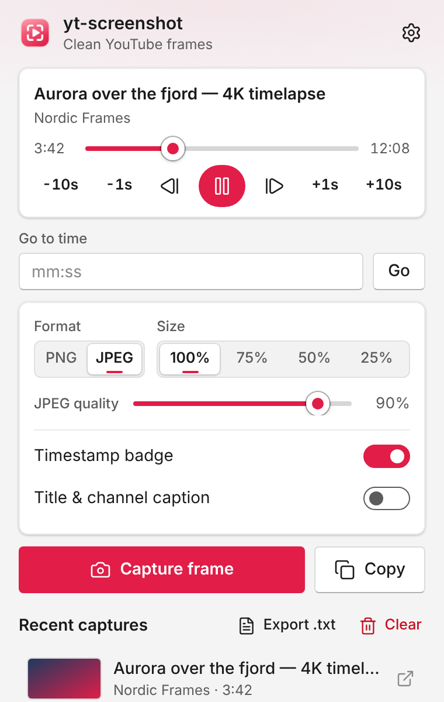
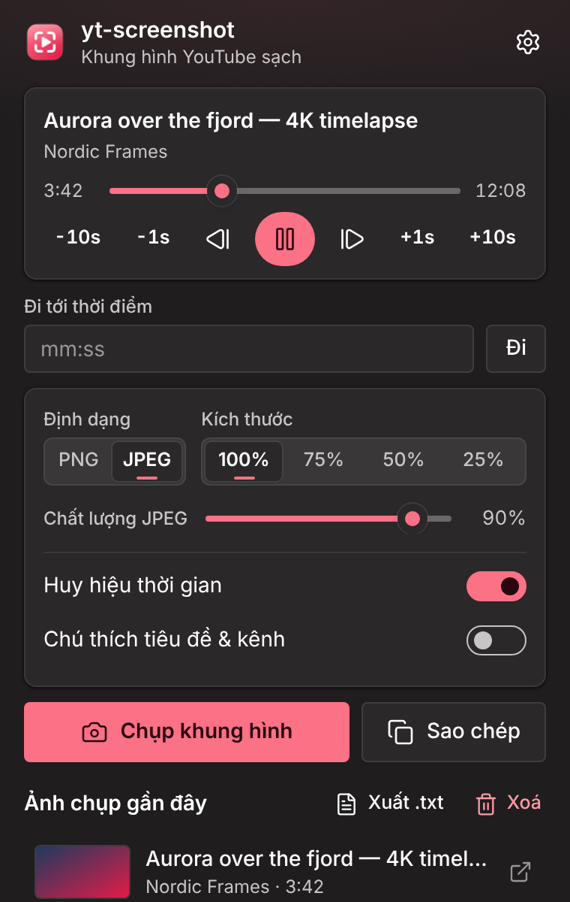
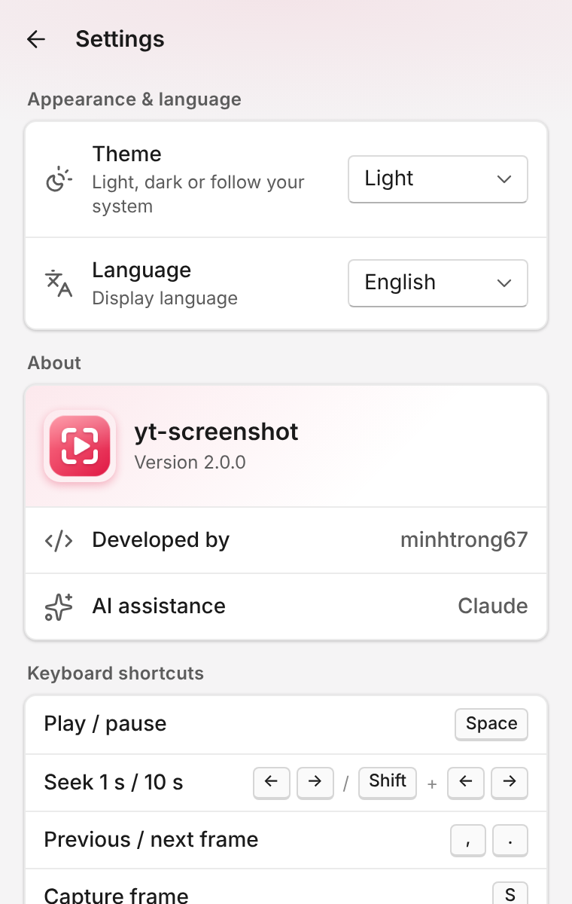

# YT Screenshot

**Chụp ảnh YouTube sạch, từng khung hình.**

Tiện ích Chrome miễn phí, mã nguồn mở, chụp khung hình không có thanh điều khiển từ bất kỳ video YouTube nào, tua chính xác từng khung, kèm huy hiệu thời gian và chú thích tuỳ chọn, giao diện Fluent Design.

[English](README.md) · **Tiếng Việt**

---

## Ảnh chụp màn hình

| | | |
|:---:|:---:|:---:|
|  Giao diện sáng |  Giao diện tối, Tiếng Việt |  Cài đặt |

## Tính năng

- **Khung hình sạch**, đúng độ phân giải gốc của video.
- **Tua chính xác**: ±10 giây, ±1 giây, từng khung hình, thanh kéo hoặc nhập thời gian như `1:23`.
- **Huy hiệu thời gian và chú thích** tiêu đề / kênh.
- **PNG hoặc JPEG** ở 100, 75, 50 hoặc 25 phần trăm, chỉnh được chất lượng JPEG.
- **Lưu hoặc sao chép** vào clipboard.
- **Phím tắt** trong popup: `Space` phát/dừng, `←` `→` tua (giữ `Shift` để tua 10 giây), `,` `.` lùi/tiến một khung, `S` chụp, `C` sao chép.
- **Ảnh chụp gần đây** kèm ảnh thu nhỏ; bấm để mở lại video đúng giây đó, hoặc xuất `.txt`.
- **Fluent Design**: màu nhấn rose, font hệ thống, icon [Lucide](https://lucide.dev).
- **Giao diện sáng, tối hoặc theo hệ thống** và **English / Tiếng Việt** trong Cài đặt.
- **Riêng tư**: không máy chủ, không theo dõi, không cần tài khoản.

## Cài đặt

1. Giải nén gói.
2. Mở `chrome://extensions` và bật **Chế độ nhà phát triển**.
3. Chọn **Tải tiện ích đã giải nén** và trỏ tới thư mục chứa `manifest.json`.
4. Ghim **YT Screenshot**, mở một video YouTube rồi bấm vào biểu tượng.

## Ghi nhận

Phát triển bởi **minhtrong67**, với sự hỗ trợ của AI **Claude**. Phát hành theo [giấy phép MIT](LICENSE).
